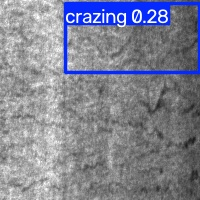
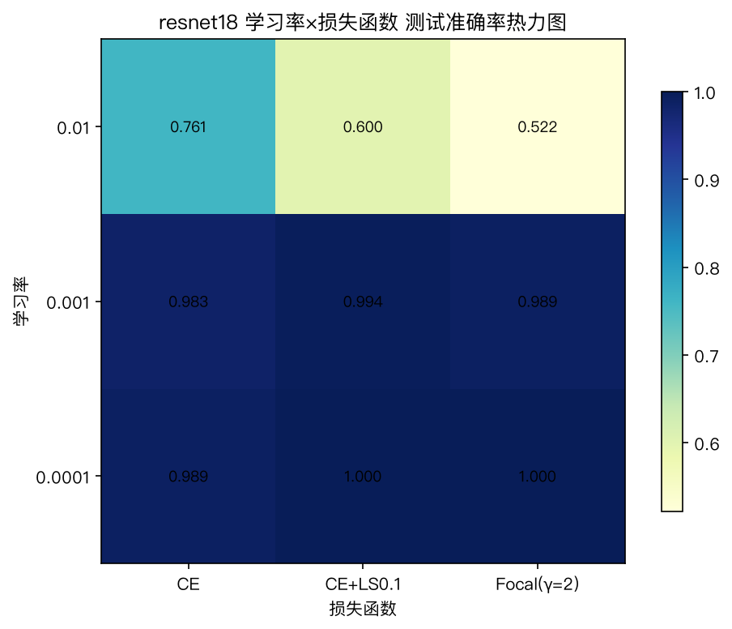

# 工业数据分析与挖掘综合实训

> 基于 **XJTU-SY 轴承振动数据** 与 **NEU-DET 金属表面瑕疵图像** 的故障诊断、剩余寿命预测、缺陷分类检测与工业智能体实践。

项目覆盖「数据探索 → 特征工程 → 建模评估 → 调优消融 → 智能体集成」完整闭环，全部脚本可直接运行，实验数字均来自真实数据集的完整运行。

| 数据线 | 任务 | 代表方法 | 主要结果 |
| --- | --- | --- | --- |
| XJTU-SY 轴承 | 健康阶段三分类（按轴承留出） | 手工特征 + RandomForest | 准确率 **0.7820**，macroF1 **0.7202** |
| XJTU-SY 轴承 | 剩余寿命回归 | GradientBoosting / LSTM | 测试 MAE **0.2615**（GBoost） |
| NEU-DET 表面 | 六类瑕疵分类 | ResNet18 / EfficientNet-B0 迁移学习 | 准确率 **0.9944** / **0.9889** |
| NEU-DET 表面 | 缺陷检测 | YOLOv8n 预训练微调 | mAP50 **0.7703**，mAP50-95 **0.4362** |
| 智能体 | 设备运维诊断 / 视觉质检 | IsolationForest + 分类/RUL + RAG | 两个可离线演示的 CLI 智能体 |
| 智能体 | 可视化智能体（TypeScript Web） | React + ECharts + DeepSeek + YOLOv8n | 在线问答、按需出图、CSV 上传、图片缺陷检测、历史会话；主界面选题后进入工作区 |

| 缺陷检测（YOLOv8n） | 学习率 × 损失消融 |
| :---: | :---: |
|  |  |

## 项目结构

```
.
├── src/
│   ├── common/                  # 数据加载、50 维特征、DL/CV 训练公共件、中文绘图
│   ├── week1-bearing-ml/        # 探索 → 特征 → 相关性 → 分类 → RUL 回归
│   ├── week2-bearing-dl/        # RNN / LSTM / 1D-CNN / LSTM-RUL
│   ├── week2-3-surface-defect/  # NEU-DET 探索、ResNet/EfficientNet、YOLO、消融
│   ├── agent-maintenance/       # 设备运维诊断智能体
│   ├── agent-inspection/        # 视觉质检智能体（SQLite 台账 + RAG + 预警）
│   └── agent-unified/          # 统一入口：运维 + 质检 + 基础对话
├── agent-visualization/         # TypeScript 可视化智能体（主界面 + 工作区 + YOLO 缺陷检测）
├── scripts/smoke_test.sh        # 合成小数据全链路自检（18 个入口脚本）
├── config/                      # 轴承几何参数
├── docs/                        # 实训指南与规划思维导图
├── data/README.md               # 数据集布局与下载说明
├── results/                     # 报告图表与 YOLO 汇总（完整训练产物本地生成，不入库）
├── 实训手册/                     # 12 天每日记录
└── 实训报告/                     # 完整实训报告
```

## 快速开始

要求 Python 3.13（3.10+ 亦可）。依赖：numpy / scipy / scikit-learn / pandas / matplotlib / torch / torchvision / ultralytics。

```bash
git clone https://github.com/Huaiyue-sy/-.git 工业数据分析与挖掘综合实训
cd 工业数据分析与挖掘综合实训

python3 -m venv .venv
source .venv/bin/activate
pip install -r requirements.txt
cp .env.example .env   # 可选：填入 DEEPSEEK_API_KEY，智能体优先走在线大模型

# 数据集不随仓库分发，放置方式见 data/README.md
# XJTU-SY → data/XJTU-SY_Bearing_Datasets/
# NEU-DET  → data/NEU-DET/（分类）与 data/NEU-DET-yolo/（检测）

# 用合成小数据验证全部入口可运行（不会污染正式结果）
bash scripts/smoke_test.sh
```

## 复现实验

```bash
# 第 1 周：轴承特征工程与传统机器学习
.venv/bin/python src/week1-bearing-ml/01_explore.py
.venv/bin/python src/week1-bearing-ml/02_features.py
.venv/bin/python src/week1-bearing-ml/03_correlation.py
.venv/bin/python src/week1-bearing-ml/04_classify.py
.venv/bin/python src/week1-bearing-ml/05_rul_regression.py

# 第 2 周：RNN / LSTM / CNN 与 LSTM-RUL
.venv/bin/python src/week2-bearing-dl/01_verify_env.py
.venv/bin/python src/week2-bearing-dl/02_rnn_classifier.py
.venv/bin/python src/week2-bearing-dl/03_lstm_classifier.py
.venv/bin/python src/week2-bearing-dl/04_lstm_rul.py
.venv/bin/python src/week2-bearing-dl/05_cnn_classifier.py

# 第 2-3 周：NEU-DET 分类、检测与消融
.venv/bin/python src/week2-3-surface-defect/01_explore_neu.py --neu-dir data/NEU-DET
.venv/bin/python src/week2-3-surface-defect/02_resnet_classify.py
.venv/bin/python src/week2-3-surface-defect/03_efficientnet_classify.py
# 检测需 YOLO 布局：VOC 版先跑 convert_voc_to_yolo.py；yolov8n.pt 放项目根目录
.venv/bin/python src/week2-3-surface-defect/04_yolo_detect.py --neu-dir data/NEU-DET-yolo
.venv/bin/python src/week2-3-surface-defect/05_optimize.py
```

## 智能体演示

**设备运维诊断**（异常检测 → 健康阶段 → RUL → 包络谱定位 → 报告）：

```bash
.venv/bin/python src/agent-maintenance/main.py
/scan data/XJTU-SY_Bearing_Datasets/35Hz12kN/Bearing1_1/123.csv
/report data/XJTU-SY_Bearing_Datasets/35Hz12kN/Bearing1_1/123.csv
/ask 外圈故障应该怎么处理？
/score Bearing1_4
```

**视觉质检**（检测入库 → 自然语言查询 → 连续缺陷预警 → 工艺 RAG）：

```bash
.venv/bin/python src/agent-inspection/main.py
/inspect data/NEU-DET/IMAGES/scratches_10.jpg 3号机台
/inspect data/NEU-DET/IMAGES/scratches_11.jpg 3号机台
/inspect data/NEU-DET/IMAGES/scratches_12.jpg 3号机台
/query 最近哪种缺陷最多？
/alerts
/query 麻点的工艺原因是什么？
```

## 统一智能体（运维 + 质检 + 对话）

`src/agent-unified/` 把两个智能体合并为一个入口，并增加带上下文的基础对话。可以直接用自然语言路由：

```bash
.venv/bin/python src/agent-unified/main.py

诊断 data/XJTU-SY_Bearing_Datasets/35Hz12kN/Bearing1_1/123.csv
生成报告 data/XJTU-SY_Bearing_Datasets/35Hz12kN/Bearing1_1/123.csv
检测 data/NEU-DET/IMAGES/scratches_10.jpg 3号机台
3号机台最近有什么异常？
划伤是什么工艺原因？
项目目前的模型指标怎么样？
```

也保留 `/scan`、`/report`、`/inspect`、`/query`、`/alerts`、`/status`、`/rag`、`/chat`、`/reset`、`/history` 显式命令。

两个智能体均支持 **DeepSeek API 优先、离线前确认**：设置 `DEEPSEEK_API_KEY`（环境变量，或项目根目录 `.env` / `config/deepseek.env`）时由大模型生成报告；无 key 或调用失败时不会自动切换，CLI 会先询问 `[y/N]`，确认后才使用同结构的离线规则模板。`.env` 已被 `.gitignore` 忽略，不会提交。

> 智能体依赖 `models/` 下的分类、RUL 与 ResNet 权重（如 `week1_classifier.joblib`、`resnet18_neu.pth`）。这些文件体积较大且不入库，请先按上一节命令训练生成，或把本机 `models/` 目录复制过来。

## 可视化智能体（TypeScript Web）

第三个智能体在浏览器里用自然语言分析数据，并能直接检测表面缺陷。主界面先完成数据选择与提问（数据面板默认折叠，展开后选内置数据或上传 CSV），确认后进入工作区；工作区左侧保留历史会话，右侧展示 ECharts 图表或 YOLO 标注结果。

- **数据分析**：内置 10 个实训结果数据集；完整 `features.csv` 存在时使用 9216 行全量，否则退回 600 行抽样快照。模型返回自由文字 + 可选图表规格，支持折线、柱状、散点、箱线、热力、饼图、直方图与 PNG 导出。
- **缺陷检测**：附加图片后界面自动切换为「表面缺陷检测模式」，调用项目根目录 `.venv` 中的 Ultralytics 与 `best.pt`，返回缺陷框、类别计数、标注图，并由在线模型解读，可导出 JPG。
- **历史会话**：对话保存在浏览器 localStorage（最多 15 条），支持恢复、单条删除与清空。
- **在线模型**：所有问答统一交给 OpenAI 兼容的 DeepSeek；图表规格经 zod 校验。纯在线模式，未配置或调用失败直接报错，不提供离线规则引擎。API key 只保留在服务端 `.env`。

```bash
cd agent-visualization
npm install
cp .env.example .env   # 必填：在线模型 key；可选 VIZ_YOLO_MODEL / VIZ_PYTHON / VIZ_YOLO_CONF
npm run dev            # 前端 http://localhost:5173，后端 http://localhost:8787
```

YOLO 检测需要项目根目录 `.venv/bin/python`（含 ultralytics）和 `results/week2_3/yolo/train/weights/best.pt`，默认自动发现。详细说明见 [agent-visualization/README.md](agent-visualization/README.md)。

## 设备健康看板与推送

在 Web 智能体里新增「设备看板」入口：把轴承特征表转换成 0–100 分的健康分、四级状态、趋势与告警，支持 SSE 实时推送、历史回放和机器人推送。

```bash
# 1) 生成评分（每个文件一行 + 每台设备摘要）
.venv/bin/python src/agent-maintenance/score_devices.py

# 2) 启动 Web 后点击首页右上角「设备看板」
cd agent-visualization
npm run dev
```

评分口径（可解释规则加权，不是新训练模型）：

```text
健康分 = 30%·RMS 得分 + 20%·峭度得分 + 20%·包络峰值得分
       + 20%·健康阶段得分 + 10%·相对 RUL 得分
级别：≥85 健康 / ≥70 注意 / ≥50 警告 / <50 危险
基线：每台轴承前 20% 文件的稳健中位数
```

- 输出：`results/health_scores.csv`（9216 行，逐文件评分与告警）、`results/health_devices.json`（15 台设备最新状态）。
- 看板：设备列表、分数环、阶段/RUL/RMS/包络倍数、健康分趋势、最近告警、评分依据、回放退化过程。
- 实时推送：`GET /api/dashboard/stream`（SSE）；回放时推送 `update` / `alert` 事件。
- 机器人推送：在 `agent-visualization/.env` 配置 `VIZ_ALERT_WEBHOOK`（钉钉/企业微信自定义机器人），点击「推送当前告警」或调用 `POST /api/dashboard/push`；未配置时返回 503，不伪造发送成功。
- 全部 15 台轴承均为全寿命试验，末端状态多为“危险”；点击「回放退化过程」可查看从健康到失效的评分变化。

## 评估口径

- 轴承任务默认 **按轴承留出**（Bearing1_4 / Bearing2_3 / Bearing3_2 测试），避免相邻文件泄漏；随机划分仅作对照。
- 图像任务分层 **8:1:1** 划分（seed=42）；分类看准确率与 macroF1，检测看 mAP50 / mAP50-95。
- 第 1 周同轴承 5 折 CV 可达 0.99，但跨轴承留出后 RF 为 0.7820；RNN/LSTM 的 0.8347 实为全部判成“健康”（macroF1 0.3033）。报告如实保留这些负面对照。

## 文档

- [项目正式报告](实训报告/项目正式报告.md)：完整版报告，覆盖数据、算法、YOLO 训练与性能、智能体架构、系统测试与复现
- [实训报告](实训报告/实训报告.md)：需求分析、系统设计、编码实现、系统测试、智能体应用、问题与改进
- [实训手册](实训手册/)：12 天每日记录（目标、完成情况、问题与解决、次日计划）
- [数据说明](data/README.md)：两个数据集的下载、目录布局与几何参数
- [代码目录说明](src/README.md)：每个脚本的输入输出与用法
- [可视化智能体](agent-visualization/README.md)：TypeScript Web 应用的结构、API 与使用说明

## 环境说明

本机实验环境为 macOS（Apple M5，PyTorch 2.15 CPU/MPS）。NVIDIA 机器可按实训指南安装 CUDA 版 PyTorch；所有脚本通过命令行参数指定数据与输出目录，不依赖固定路径。

## 致谢

- XJTU-SY 滚动轴承加速寿命试验数据集（西安交通大学）
- NEU-DET 热轧带钢表面缺陷数据集（东北大学）
- [Ultralytics YOLOv8](https://github.com/ultralytics/ultralytics)

本项目为课程实训作品，未附开源许可证；复用数据集与预训练权重时请遵循其原始许可。
