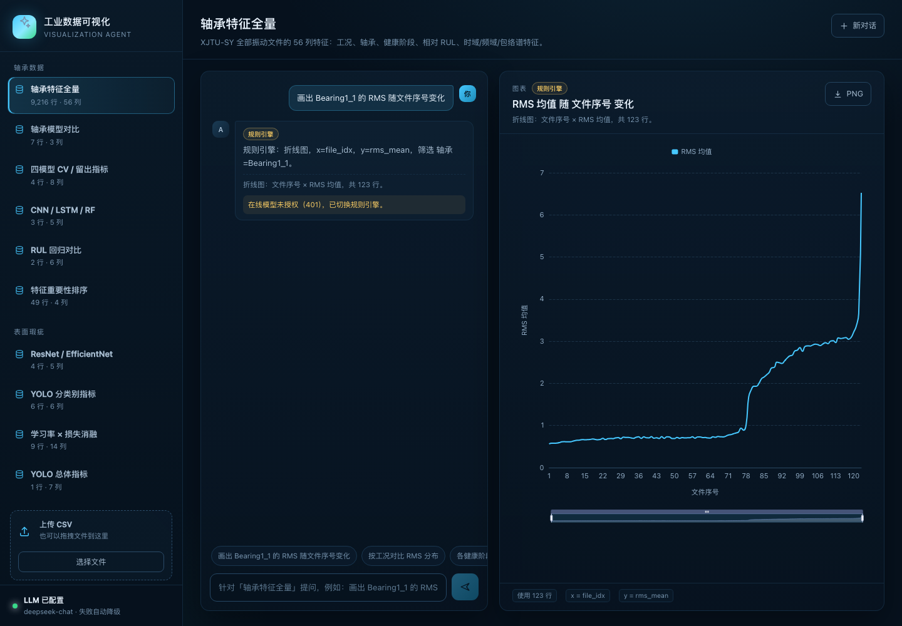

# 工业数据可视化智能体（TypeScript）

用自然语言把工业数据变成交互式图表：选择内置实训结果或上传 CSV，输入“画出……”“对比……”“按……分布”，服务端先生成受约束的图表规格，再由 ECharts 渲染。



## 功能

- **内置实训结果**：轴承特征、模型对比、RUL、ResNet/EfficientNet、YOLO、消融实验等 10 个数据集。
- **CSV 上传**：自动推断数值/类别/日期字段，支持任意列名与中文表头。
- **自然语言转图表**：折线、柱状、散点、箱线、热力、饼图、直方图七种图表。
- **两种规划通道**：OpenAI 兼容接口优先（默认 DeepSeek），失败或字段不合法时自动切换本地规则引擎。
- **服务端保管密钥**：浏览器不接触 API key；只把字段画像和问题发给模型，不上传整份数据。
- **导出 PNG**：图表右上角一键导出，方便放进报告或汇报 PPT。
- **可分享演示链接**：`http://localhost:5173/?q=画出 Bearing1_1 的 RMS 随文件序号变化` 自动执行一次提问。

## 快速开始

```bash
cd agent-visualization
npm install

# 可选：配置大模型；不配也能用规则引擎完整演示
cp .env.example .env
# 或直接复用项目根目录 .env 中的 DEEPSEEK_API_KEY

npm run dev
# 前端 http://localhost:5173
# 后端 http://localhost:8787
```

生产模式：

```bash
npm run build
npm start
# 打开 http://localhost:8787
```

要求 Node 20+（本机 Node 25），npm 10+。

## 环境变量

优先级：`agent-visualization/.env` > 项目根目录 `.env` > 进程环境变量。

| 变量 | 说明 | 默认 |
| --- | --- | --- |
| `VIZ_LLM_API_KEY` | 可视化智能体专用 key | 回退 `DEEPSEEK_API_KEY` |
| `VIZ_LLM_BASE_URL` | OpenAI 兼容地址 | `https://api.deepseek.com` |
| `VIZ_LLM_MODEL` | 模型名 | `deepseek-chat` |
| `PORT` | 后端端口 | `8787` |

任何 OpenAI 兼容服务都可以用，只要实现 `POST /chat/completions`。密钥只存在服务端，`.env` 已被 `.gitignore` 忽略。

## 数据

- `agent-visualization/data/` 是随仓库分发的小型快照，保证克隆后即可演示。
- 如果本机存在 `results/week1/features.csv`，会优先使用完整 9216 行数据；否则自动使用 `bearing_features_sample.csv`（600 行分层抽样）。
- 上传文件只保存在服务端内存（限制 25 MB、最多 5 万行），重启后清空。

内置数据集：

| 数据集 | 内容 |
| --- | --- |
| 轴承特征全量 | 56 列：工况、轴承、健康阶段、相对 RUL、时域/频域/包络特征 |
| 轴承模型对比 | RF / SVM / KNN / LR / CNN / LSTM / RNN 的准确率与 macroF1 |
| 四模型 CV / 留出指标 | 第 1 周四模型的 CV 与按轴承留出测试指标 |
| CNN / LSTM / RF | 第 2 周深度模型与随机森林同口径对比 |
| RUL 回归对比 | GBoost / RF / LSTM 的 MAE、RMSE、R² |
| 特征重要性排序 | 互信息与 ANOVA 排序 |
| ResNet / EfficientNet | NEU-DET 六分类预训练/从零对照 |
| YOLO 分类别指标 | 六类缺陷的 P / R / mAP50 / mAP50-95 |
| 学习率 × 损失消融 | 3 × 3 网格的测试准确率 |
| YOLO 总体指标 | mAP50、mAP50-95、mP、mR |

## 架构

```text
web/ (React + Vite + ECharts)
   │  POST /api/chat { datasetId, question }
   ▼
server/index.ts (Express + TypeScript)
   ├── datasets.ts    CSV 读取、字段画像、内置数据、上传缓存
   ├── llm.ts         OpenAI 兼容调用 + zod 校验 + 失败降级
   ├── planner.ts     本地规则：列名/别名匹配、图表类型、筛选、排序
   └── chart.ts       聚合/分组/分位数/热力矩阵 → ECharts option
```

图表规格是一个受限 JSON：

```json
{
  "type": "line",
  "title": "RMS 均值 随 文件序号 变化",
  "x": "file_idx",
  "y": "rms_mean",
  "series": "stage",
  "agg": "mean",
  "filter": { "column": "bearing", "value": "Bearing1_1" },
  "sort": "asc",
  "limit": 300
}
```

服务端会校验每个字段真实存在、y 必须是数值列，再做聚合与渲染。模型不可用或输出非法时，规则引擎用同一套规格结构兜底。

## API

| 方法 | 路径 | 说明 |
| --- | --- | --- |
| GET | `/api/health` | 服务状态与 LLM 配置 |
| GET | `/api/datasets` | 内置数据集元信息 |
| GET | `/api/datasets/:id` | 单个数据集元信息 |
| POST | `/api/datasets/upload` | multipart `file=<csv>` |
| POST | `/api/chat` | `{ "datasetId": "...", "question": "..." }` |

## 示例问题

- 画出 Bearing1_1 的 RMS 随文件序号变化
- 按工况对比 RMS 分布
- 健康阶段与 RMS 的关系
- 对比各模型的测试准确率和 macroF1
- 对比 RUL 模型的测试 MAE 和 RMSE
- 画出六类缺陷的 mAP50 柱状图
- 画学习率×损失函数的测试准确率热力图
- 画互信息 Top 15 特征条形图

## 测试与类型检查

```bash
npm run typecheck
npm run build
```

本项目与主仓库的 Python 实训代码相互独立；可视化智能体只读取 `results/` 或自身 `data/` 中的 CSV，不修改训练产物。
