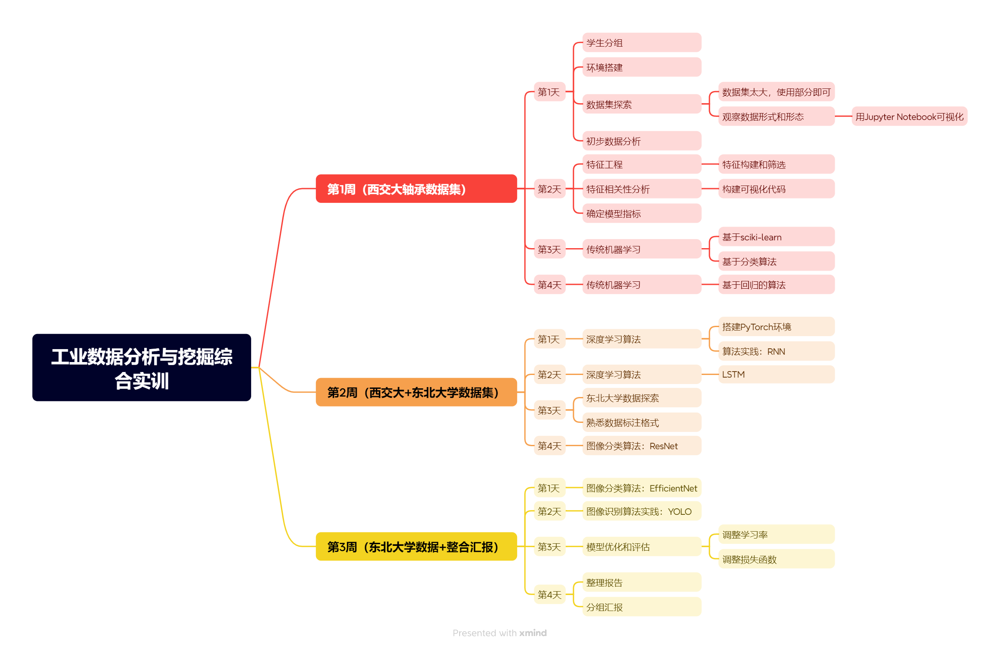

# 工业数据分析与挖掘综合实训指南（26年下）

> 本文档是工业数据分析与挖掘综合实训指南，适用于工业互联网技术专业23级学生，各位老师可将本文档发给学生，也可以适当调整内容安排。

- 来源：<https://www.yuque.com/lyliu/ifi7a4/fgk4mhlu44it6g36?singleDoc>
- 语雀创建：2026-10-28　最后更新：2026-10-28（UTC）　正文字数：1120
- 抓取整理日期：2026-11-02

## 实训内容规划



思维导图文字版：

- **第1周（西交大轴承数据集）**
  - 第1天
    - 学生分组
    - 环境搭建
    - 数据集探索
      - 数据集太大，使用部分即可
      - 观察数据形式和形态 —— 用 Jupyter Notebook 可视化
    - 初步数据分析
  - 第2天
    - 特征工程 —— 特征构建和筛选
    - 特征相关性分析 —— 构建可视化代码
    - 确定模型指标
  - 第3天
    - 传统机器学习 —— 基于 sciki-learn、基于分类算法
  - 第4天
    - 传统机器学习 —— 基于回归的算法
- **第2周（西交大+东北大学数据集）**
  - 第1天
    - 深度学习算法 —— 搭建 PyTorch 环境、算法实践：RNN
  - 第2天
    - 深度学习算法 —— LSTM
  - 第3天
    - 东北大学数据探索
    - 熟悉数据标注格式
  - 第4天
    - 图像分类算法：ResNet
- **第3周（东北大学数据+整合汇报）**
  - 第1天
    - 图像分类算法：EfficientNet
  - 第2天
    - 图像识别算法实践：YOLO
  - 第3天
    - 模型优化和评估 —— 调整学习率、调整损失函数
  - 第4天
    - 整理报告
    - 分组汇报

以上是实训大致规划，各个班级各位老师可以根据情况调整算法以及相关实训时间。

## 考核

- 过程考核60%，结果考核40%；
- 无故旷课一天以上实训不予通过，请假超过十个学时实训不予通过；
- 分组推进开发，分组成员轮流汇报程序开发进展；
- 过程考核注重平时实训表现，结果考核注重功能实现、代码质量以及文档质量；
- 请每天在**实训手册**上**详细记录**当天的实训情况，实训手册双面打印成册（可咨询打印店A3打印对折）；
- **实训报告**需要详细记录从软件需求分析、编码实现、系统测试整个开发周期，请每个同学在平时积累文档最终；汇总成实训报告；
- 实训课上请勿干无关的事情，课堂纪律是过程考核的重要指标。

## 实训内容

### 数据分析层面

- **西交大轴承数据**：完成振动信号的时域/频域特征提取、故障分类建模（CNN/LSTM/随机森林对比），输出诊断准确率报告。此外，可根据数据对某些轴承做剩余寿命预测（RUL）。
- **NEU-DET金属表面瑕疵数据**：训练 YOLO 或 ResNet 做缺陷检测与分类，掌握数据增强、模型评估等 CV 基础流程。

### 智能体开发层面

结合本学期关于智能体技术的课堂学习，在工业数据分析的基础上开发工业智能体应用。

#### 设备运维诊断智能体

参考工业界"AI老师傅"的思路，搭建一个能自主工作的诊断智能体：

- 实时读取振动数据，用无监督方法（如 Isolation Forest）做异常检测；也可根据其他设备的历史数据做监督训练，用未训练数据回测，实现异常检测；
- 检测到异常后，根据 `3.1` 设计的分类模型，预测故障类型和剩余寿命；
- 调用大模型生成结构化诊断报告：故障类型、处置建议等内容；
- 输出可交互的对话界面，模拟"工人提问→Agent诊断"的场景。

#### 视觉质检智能体

- 视觉模块：加载 `3.1` 节训练好的缺陷检测模型作为工具；
- 记忆模块：每次检测结果自动存入数据库，形成产线质量"数字孪生"记录；
- 推理模块：支持自然语言查询，如"最近哪种缺陷最多？""3号机台有没有异常趋势？"
- 决策模块：当某类缺陷连续出现时，主动发出预警并关联可能的工艺原因（可以自定义一些工艺原因做模拟，自行生成一些工艺文件用于智能体加载 RAG）。

## 附录参考

### 环境准备

#### scikit-learn

```bash
# 安装依赖
pip install numpy scipy

# 安装scikit-learn
pip install scikit-learn -i https://pypi.tuna.tsinghua.edu.cn/simple
```

#### PyTorch

##### 安装

```bash
# 带英伟达GPU
# 使用南京大学的镜像
pip3 install torch torchvision --index-url https://mirrors.nju.edu.cn/pytorch/whl/cu126

# 如果不带英伟达GPU,选择下面的命令
pip3 install torch torchvision
```

##### 验证

```python
import torch
# 查看CUDA版本（PyTorch构建时所用的CUDA工具包版本）
print(torch.version.cuda)
# 查看当前活跃的CUDA设备（显卡）数量
print(torch.cuda.device_count())
# 查看当前GPU设备名称
print(torch.cuda.get_device_name(0))
# 查看cuDNN版本（深度神经网络加速库）
print(torch.backends.cudnn.version())
```

### 西交大数据集下载地址和参考论文

下载地址：<https://pan.baidu.com/s/1OaY82azTXHBwjiCjA_jRcw>

参考论文：知网搜索《XJTU-SY滚动轴承加速寿命试验数据集解读》

### 轴承数据特征提取参考思路

<https://www.yuque.com/lyliu/ifi7a4/zogacwn75wmnua1r?singleDoc#>

### 轴承剩余寿命预测归一化

<https://www.yuque.com/lyliu/ifi7a4/aq9o6lzxrhdouu1l?singleDoc#>

### 东北大学金属表面瑕疵数据集（分类）

<https://www.yuque.com/lyliu/ifi7a4/ociycn3fgzfk17pw?singleDoc#>
