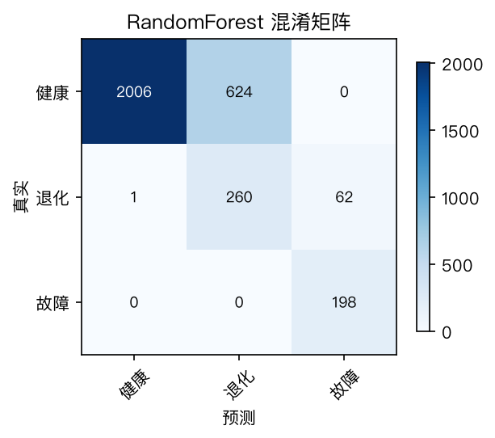
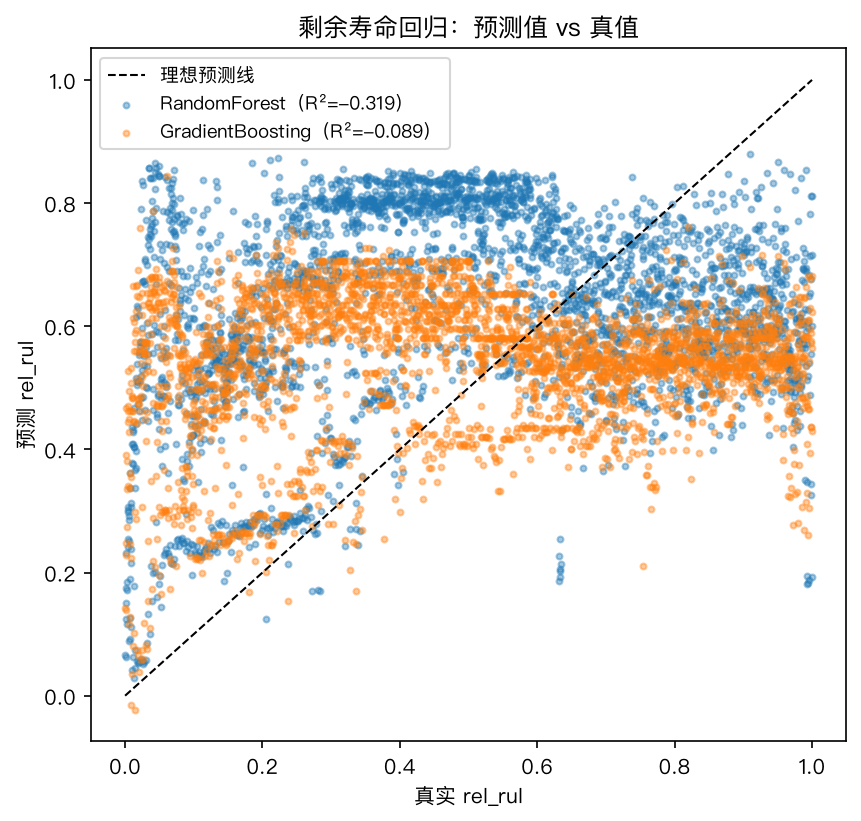
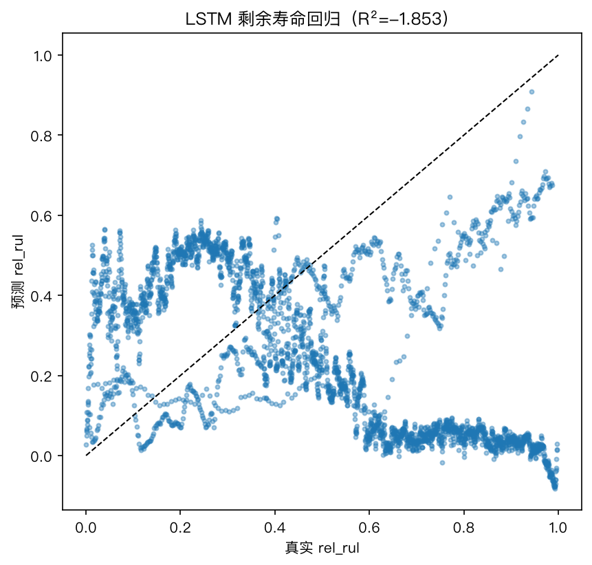
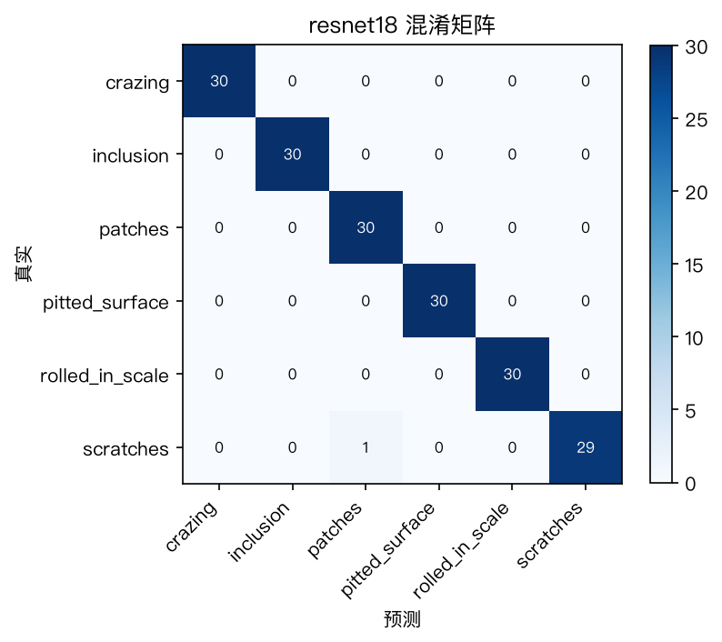
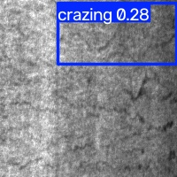
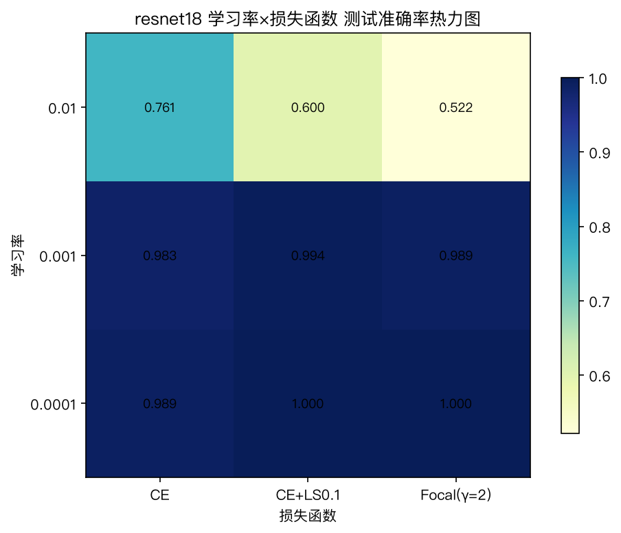

# 工业数据分析与挖掘综合实训报告

| 项目 | 内容 |
| --- | --- |
| 实训题目 | 基于工业数据的轴承故障诊断与金属表面瑕疵检测及智能体应用 |
| 专业班级 | 工业互联网技术 23 级　互联2313 |
| 学号 / 姓名 | 2305271310　孙勇 |
| 组员 | 孙勇、组员A、组员B、组员C（提交前替换为真实姓名与学号） |
| 实训时间 | 2026-11-02 ～ 2026-11-19（三周） |
| 代码仓库 | 本仓库 `src/`（三周脚本 + 两个智能体 + 冒烟测试） |

> 数据说明：文中实验数字均来自本机对真实数据集的完整运行（XJTU-SY 9216 个振动 CSV、
> NEU-DET 1800 张图像），图表文件位于 `results/`，终端记录位于 `results/logs/`。

---

## 1. 实训概述

本次实训以两条工业数据主线贯穿三周：**西交大 XJTU-SY 轴承加速寿命数据**（振动信号分析、
故障分类与剩余寿命预测）和**东北大学 NEU-DET 金属表面瑕疵数据**（图像分类与目标检测），
并在第三周把模型整合为两个工业智能体应用：**设备运维诊断智能体**与**视觉质检智能体**。

进度对照（依据 `docs/` 实训内容规划思维导图）：

| 周 | 日（日期） | 主要工作 | 对应交付 |
| --- | --- | --- | --- |
| 1 | 第1天 11/02 | 分组、环境搭建、XJTU-SY 探索 | `01_explore.py` |
| 1 | 第2天 11/03 | 特征工程 + 相关性分析 | `02_features.py`、`03_correlation.py` |
| 1 | 第3天 11/04 | 传统机器学习分类 | `04_classify.py` |
| 1 | 第4天 11/05 | 回归算法（RUL） | `05_rul_regression.py` |
| 2 | 第1天 11/09 | PyTorch 环境、RNN | `week2/01`、`02` |
| 2 | 第2天 11/10 | LSTM（含 CNN 扩展对比） | `week2/03`、`05` |
| 2 | 第3天 11/11 | NEU-DET 探索、标注格式 | `week2-3/01`、转换脚本 |
| 2 | 第4天 11/12 | ResNet 分类 | `week2-3/02` |
| 3 | 第1天 11/16 | EfficientNet、智能体设计 | `week2-3/03` |
| 3 | 第2天 11/17 | YOLO、运维诊断智能体 | `week2-3/04`、`agent-maintenance/` |
| 3 | 第3天 11/18 | 调优消融、视觉质检智能体 | `week2-3/05`、`agent-inspection/` |
| 3 | 第4天 11/19 | 联调演示、报告、汇报 | 本报告 + 演示 |

分组分工：孙勇负责总体架构、轴承数据分析线与两个智能体核心编码；组员A 负责 NEU-DET
数据整理与 EfficientNet 实验记录；组员B 负责深度学习实验与结果汇总；组员C 负责标注格式
研究、工艺文件撰写与文档校对。每天轮值汇报（见《实训手册》各日记录）。

## 2. 需求分析

### 2.1 业务背景

- **轴承故障诊断**：旋转机械中滚动轴承是最易损部件之一。通过振动信号在线判别健康状态、
  定位故障元件（内/外圈、滚动体、保持架）并预测剩余寿命（RUL），可以把"事后维修"
  升级为"预测性维护"，减少非计划停机。
- **表面瑕疵质检**：热轧带钢表面缺陷（龟裂、夹杂、斑块、麻点、氧化铁皮压入、划痕）传统上
  依赖人工目检，效率低且标准不一。用视觉模型自动检出并分类缺陷，检测结果沉淀为质量台账后，
  还能反推工艺环节的异常趋势。

### 2.2 数据来源与规模

**表 2-1　XJTU-SY 轴承数据集概况**

| 项目 | 内容 |
| --- | --- |
| 来源 | 西安交通大学 + Sumyoung 公司，百度网盘下载（链接见实训指南附录） |
| 规模 | 3 种工况（转速 2100/2250/2400 rpm × 载荷 12/11/10 kN）× 每工况 5 个轴承，共 15 套全寿命数据、9216 个 CSV（约 16 GB），直至失效 |
| 采样 | 加速度计两通道（水平/垂直），25.6 kHz，每 1 分钟采 1.28 s，每文件 32768 点 |
| 实训用法 | 数据量大，按指南"使用部分即可"：`--max-files` 每轴承取前 N 文件 |
| 几何参数 | 试验轴承 LDK UER204：滚珠数 Z=8，球径 d=7.92 mm，中径 D=34.55 mm，接触角 α=0°（取自《数据集解读》表 1，已写入 `BearingGeometry` 默认值与 `config/xjtu_bearing_geometry.json`） |

**表 2-2　NEU-DET 金属表面瑕疵数据集概况**

| 项目 | 内容 |
| --- | --- |
| 来源 | 东北大学，链接见指南附录 |
| 规模 | 1800 张 200×200 灰度图，6 类各 300 张；检测版带矩形框标注 |
| 类别 | crazing 龟裂 / inclusion 夹杂 / patches 斑块 / pitted_surface 麻点 / rolled-in_scale 氧化铁皮压入 / scratches 划痕 |
| 布局兼容 | 代码自动识别分类布局、YOLO 布局、VOC 布局（`common/neu.py::detect_layout`） |

### 2.3 功能需求

| 编号 | 需求 | 实现位置 |
| --- | --- | --- |
| FR-01 | 轴承数据集探索与可视化（波形/频谱/包络谱/退化曲线） | `week1/01_explore.py` |
| FR-02 | 时域/频域/包络谱特征提取与健康阶段标注 | `week1/02_features.py` |
| FR-03 | 特征相关性分析与 Top-K 筛选 | `week1/03_correlation.py` |
| FR-04 | 传统机器学习故障分类（≥3 种算法对比） | `week1/04_classify.py` |
| FR-05 | 剩余寿命（RUL）回归预测 | `week1/05_rul_regression.py` |
| FR-06 | 深度学习分类：RNN/LSTM/CNN 对比 | `week2/02、03、05` |
| FR-07 | 深度学习 RUL 回归 | `week2/04_lstm_rul.py` |
| FR-08 | NEU-DET 探索与标注格式转换 | `week2-3/01`、`convert_voc_to_yolo.py` |
| FR-09 | ResNet / EfficientNet 六分类 | `week2-3/02、03` |
| FR-10 | YOLO 缺陷检测 | `week2-3/04` |
| FR-11 | 学习率/损失函数调优 | `week2-3/05` |
| FR-12 | 运维诊断智能体：异常检测→分类/RUL→大模型报告→对话 | `agent-maintenance/` |
| FR-13 | 质检智能体：检测入库、自然语言查询、连续缺陷预警、RAG | `agent-inspection/` |

### 2.4 非功能需求

- **可复现**：随机种子固定（seed=42）；划分、特征清单、超参全部落盘（JSON/CSV）；
  `requirements.txt` 固化依赖版本。
- **评估可信**：分类/回归默认**按轴承留出**测试，避免相邻文件泄漏（详见 5.1）。
- **离线可用**：智能体在无 API key、无外网时仍可完整演示（规则引擎降级）。
- **数据布局无关**：两个数据集的常见流通版本均可直接读入，减少人工整理。

## 3. 系统设计

### 3.1 总体架构

系统按"**算法内核 + 智能体外壳**"双线组织（图 3-1）：

```
数据层     data/XJTU-SY_Bearing_Datasets  ·  data/NEU-DET（分类/YOLO/VOC 布局）
              │                                   │
公共层     common/bearing.py  features.py  dl.py  cv.py  neu.py  plotting.py
              │                                   │
算法内核   week1 特征工程+传统ML ──► features.csv ──► week2 RNN/LSTM/CNN/RUL
           week2-3 NEU-DET：ResNet/EfficientNet 分类 + YOLO 检测 + 消融调优
              │                                   │
模型层     models/week1_classifier.joblib · week1_rul.joblib · resnet18_neu.pth ...
              │                                   │
智能体外壳 agent-maintenance（运维诊断）      agent-inspection（视觉质检）
           异常检测→分类/RUL→大模型报告→对话   检测→入库→查询→预警→RAG
```
**图 3-1　系统总体架构（数据层 → 公共层 → 算法内核 → 模型层 → 智能体外壳）**

核心枢纽是 `results/week1/features.csv`：第 1 周产出（特征 + 阶段标签 + rel_rul + 原文件
路径），第 2 周深度学习与运维诊断智能体都消费它，保证"同一份数据、同一套标签口径"。

### 3.2 模块划分

| 模块 | 职责 |
| --- | --- |
| `common/` | 数据加载与发现、50 维特征提取、DL/CV 训练公共件、绘图（中文字体自适应） |
| `week1-bearing-ml/` | 探索 → 特征 → 相关性 → 分类 → RUL，5 个按天编号的脚本 |
| `week2-bearing-dl/` | PyTorch 环境验证、RNN/LSTM/CNN 分类、LSTM-RUL |
| `week2-3-surface-defect/` | NEU-DET 探索、ResNet/EfficientNet、YOLO、调优消融、VOC 转换 |
| `agent-maintenance/` | `anomaly.py` 异常检测、`diagnose.py` 诊断链路、`report.py` 报告渲染、`llm.py` 大模型接入、`main.py` 对话界面 |
| `agent-inspection/` | `detect_tool.py` 视觉工具、`store.py` SQLite 台账、`query.py` 自然语言查询、`rag.py` 工艺文件 RAG、`alert.py` 预警、`main.py` CLI |
| `scripts/` | `smoke_test.sh` 全链路冒烟测试 |

### 3.3 模型选型理由

**表 3-1　选型理由**

| 任务 | 模型 | 理由 |
| --- | --- | --- |
| 异常检测 | Isolation Forest | 无监督、无需故障标签，健康期数据即可训练，适合在线值守 |
| 故障分类（传统） | RF / SVM / KNN / LR | 覆盖树模型/核方法/距离法/线性基线，代表性与可解释性兼顾 |
| 故障分类（深度） | RNN / LSTM / 1D-CNN | RNN 为基线；LSTM 抗梯度消失适合长序列；CNN 提局部波形模式，构成指南要求的"CNN/LSTM/随机森林对比" |
| RUL | RF / GBoost / LSTM | RF/GBoost 拿手工特征做回归基线；LSTM 用滑窗特征序列建模退化过程 |
| 瑕疵分类 | ResNet18 / EfficientNet-B0 | 迁移学习小数据首选；两者参数量 11.7M vs 5.3M，可讨论效率-精度权衡 |
| 瑕疵检测 | YOLOv8n | 单阶段检测代表，工业缺陷检测主流方案，n 版训练成本低 |
| 工艺知识问答 | TF-IDF（字符 n-gram） | 中文免分词、零额外依赖，语料小（7 份工艺文件）时足够 |

## 4. 编码实现

### 4.1 环境与依赖

Python 3.13 + venv，依赖见根目录 `requirements.txt`（numpy/scipy/scikit-learn/
matplotlib/pandas/torch/torchvision/ultralytics/requests/tqdm）。PyTorch 本机为
arm64 CPU/MPS 版（`01_verify_env.py` 输出 torch=2.15.0，MPS 可用）；NVIDIA 机器按
指南用南京大学镜像装 cu126 版。

### 4.2 公共层关键实现

**数据发现（`common/bearing.py`）**：扫描工况/轴承/文件三层目录，支持 `--conditions`
`--bearings` `--max-files` 过滤；`load_vibration()` 兼容带/不带表头的 CSV。

**故障特征频率（`BearingGeometry.fault_frequencies`）**：

```python
# src/common/bearing.py —— LDK UER204 参数（Z=8, d=7.92, D=34.55, α=0°，源自《数据集解读》表 1）
c = d / D * np.cos(alpha)          # d=球径, D=中径, alpha=接触角
{"BPFO": z/2 * fr * (1 - c),       # 外圈
 "BPFI": z/2 * fr * (1 + c),       # 内圈
 "BSF":  D/(2d) * fr * (1 - c**2), # 滚动体
 "FTF":  fr/2 * (1 - c)}           # 保持架
```

**特征提取（`common/features.py`）**：每通道 25 维（时域 12 + 频域 8 + 包络谱 5），
两通道共 50 维。包络谱特征用 `scipy.signal.hilbert` 解调后在四个理论特征频率 ±3% 窗口内
取谱峰，容忍转差与滑差。

**健康阶段标签（`health_stage_labels`）**：以每轴承前 20% 文件 RMS 中位数为健康基线，
RMS ≤ 1.5×基线记 0（健康）、1.5–3× 记 1（退化）、>3× 记 2（故障）；阈值经 CLI 暴露可调。
相对剩余寿命 `rel_rul = (N−i)/N`（参考语雀归一化思路），把不同寿命的轴承拉到同一刻度。

**按轴承留出（`bearing_split_mask`）**：每 4 个轴承留 1 个做测试，训练/测试轴承不重叠，
是全部评估的默认口径。

### 4.3 传统机器学习（week1）

四个模型统一 `Pipeline(StandardScaler → 模型)`，5 折交叉验证 + 按轴承留出测试，
关键参数：RF 200 棵、SVM RBF C=10、KNN k=7、LR max_iter=5000。分类输出准确率/
macro P-R-F1/混淆矩阵，回归输出 MAE/RMSE/R²。最优模型连同特征清单、类别表 pickle 落盘。

### 4.4 深度学习（week2）

序列构造（`common/dl.py::load_sequences`）：按 `features.csv` 的 `file_path` 列映射回
原始 CSV → 垂直通道降采样到 256 点 → 逐序列 z-score。三网络共享同一数据管道与划分，
末步隐状态（RNN/LSTM）或池化特征（CNN）接全连接三分类，Adam lr=1e-3，batch=64。
LSTM-RUL：每轴承按文件顺序滑窗（W=8 × Top-20 特征）→ LSTM → FC 预测末文件 rel_rul，
特征标准化只 fit 训练集。

### 4.5 计算机视觉（week2-3）

`classification_pipeline`（`common/cv.py`）统一"分层 8:1:1 划分 → 增强（翻转/旋转）→
ImageNet 预训练换头微调 → 验证集择优 → 测试评估 → 混淆矩阵 → 存模型"，ResNet18 与
EfficientNet-B0 仅骨干不同；灰度图 `convert("L").convert("RGB")` 对齐 3 通道预训练。
YOLO 用 ultralytics：VOC 版先 `convert_voc_to_yolo.py` 转换（8:2 划分），
`yolov8n.pt` 微调，失败自动降级从零训练。消融实验支持 CE / CE+标签平滑 0.1 / Focal(γ=2)
三种损失（Focal 自实现于 `common/cv.py`）。

### 4.6 智能体实现要点

**运维诊断智能体（`agent-maintenance/`）**：`anomaly.py` 用健康期样本训练
IsolationForest（contamination=0.05）；`diagnose.py` 串起"异常判定 → 分类模型判阶段 →
RUL 模型估寿命 → 包络谱证据定位故障元件"；`llm.py` 读 `DEEPSEEK_API_KEY` 调
DeepSeek，超时/无 key 抛给 `report.py::offline_report()` 规则模板降级；`main.py` 提供
`/scan /report /ask` 对话命令。大模型 prompt 强约束"事实必须来自输入，不得编造数值"。

**视觉质检智能体（`agent-inspection/`）**：`store.py` 建表
`detections(id, ts, machine_id, image_path, defect_class, confidence)`；`query.py` 用
规则意图 + 正则（机台号 `(\d+)号`、类别中英文别名表）把自然语言转成台账统计；
`rag.py` 用 TF-IDF（`char_wb` 1-3 gram）检索 `craft_docs/` 七份模拟工艺文件；
`alert.py` 按 id 顺序计算各机台尾部连续同类缺陷数，≥3 触发二级响应预警并附 RAG 原因。

## 5. 系统测试

### 5.1 测试方案

- **链路测试**：`scripts/smoke_test.sh` 用合成小数据（`common/synthesize.py` 生成，
  XJTU-SY 布局 + NEU 两种布局）把 18 个入口脚本以最小参数跑通，防止环境损坏导致
  交付当天翻车；合成数据指标不进入本报告。
- **评估口径**：轴承任务默认按轴承留出（`--split random` 作泄漏对照）；CV 任务分层
  8:1:1（seed=42）；分类看准确率/macro-F1/混淆矩阵，回归看 MAE/RMSE/R²，检测看
  mAP50/mAP50-95。
- **冒烟结果**：18 个入口全部通过，退出码 0，日志见 `results/logs/smoke_test.log`。

### 5.2 轴承健康阶段三分类（传统机器学习）

**表 5-1　四模型对比（Top-20 特征，按轴承留出）**

| 模型 | CV 准确率 | 测试准确率 | 测试 macroF1 |
| --- | --- | --- | --- |
| RandomForest | 0.9936 ± 0.0029 | 0.7820 | 0.7202 |
| SVM-RBF | 0.9937 ± 0.0031 | 0.4541 | 0.3926 |
| KNN | 0.9931 ± 0.0019 | 0.7122 | 0.6264 |
| LogisticRegression | 0.9642 ± 0.0051 | 0.8950 | 0.6690 |

> 注：CV 为同轴承内部 5 折（相邻文件高度相关，分数偏高），测试集为完全未参与训练的
> 3 个留出轴承（Bearing1_4 / Bearing2_3 / Bearing3_2），两者差距即跨轴承泛化代价。
> 按测试 macroF1 选 RandomForest 入库。

图 5-1 各模型混淆矩阵（左：RandomForest，其余见 `results/week1/`）。



### 5.3 CNN vs LSTM vs 随机森林（同数据同划分）

**表 5-2　三类模型故障分类对比**

| 模型 | 输入 | 测试准确率 | 测试 macroF1 | 备注 |
| --- | --- | --- | --- | --- |
| 随机森林 + Top-20 特征 | 手工特征 | 0.7820 | 0.7202 | 特征工程路线，三类均有召回 |
| 1D-CNN | 原始序列 256 点 | 0.8169 | 0.3143 | 局部波形模式，召回塌缩到多数类 |
| LSTM | 原始序列 256 点 | 0.8347 | 0.3033 | 全判"健康"，长程依赖未转化为收益 |
| RNN（基线） | 原始序列 256 点 | 0.8347 | 0.3033 | 与 LSTM 同样塌缩 |

> 注：RNN/LSTM 的 0.8347 恰好等于测试集健康类占比（2630/3151），混淆矩阵中退化/故障
> 样本全部被预测为健康；门控结构在本数据上没有体现出优势，瓶颈是跨轴承幅值不可迁移。
> 对比应以 macroF1 为准：RF 0.72，CNN 0.31，RNN/LSTM 0.30。

### 5.4 剩余寿命（RUL）回归

**表 5-3　RUL 回归对比（按轴承留出，目标 rel_rul∈(0,1]）**

| 模型 | 测试 MAE | 测试 RMSE | 测试 R² |
| --- | --- | --- | --- |
| RandomForest | 0.2834 | 0.3316 | -0.3191 |
| GradientBoosting | 0.2615 | 0.3013 | -0.0891 |
| LSTM（滑窗 W=8） | 0.3977 | 0.4845 | -1.8533 |

> 注：CV MAE 分别为 0.0523 / 0.0893，留出轴承上 R² 转负——模型能拟合单轴承内部退化趋势，
> 但绝对幅值特征受工况与装配差异影响，跨轴承迁移失败；详见 5.7 讨论。

图 5-2 预测-真值散点图（RF 与 LSTM-RUL）。





### 5.5 表面瑕疵分类与检测

**表 5-4　ResNet18 vs EfficientNet-B0（六分类，8:1:1 分层划分）**

| 骨干 | 参数量 | 测试准确率 | macroF1 | 单 epoch 耗时 |
| --- | --- | --- | --- | --- |
| ResNet18 | 11.7M | 0.9944 | 0.9944 | 12.9 s |
| EfficientNet-B0 | 5.3M | 0.9889 | 0.9889 | 23.2 s |

> 注：均为 ImageNet 预训练换头微调（15 epochs，MPS）。对照实验：ResNet18 随机初始化
> 从零训练仅 0.8944，迁移学习提升约 10 个百分点；EfficientNet-B0 参数量更少、准确率低
> 0.55 pp，但在本机 MPS 上单 epoch 反而慢约 1.8 倍（深度可分离卷积等算子未充分优化）。
> 两组各 180 张测试图，0.9944 与 0.9889 实际只差 1 张。EfficientNet-B0 从零训练对照为 0.9944，
> 反超预训练版 1 张图，说明在本数据上它对预训练权重的依赖小于 ResNet18。

**表 5-5　YOLOv8n 缺陷检测（预训练微调，30 epochs / 640 px / batch 16）**

| 指标 | 取值 |
| --- | --- |
| mAP50 | 0.7703 |
| mAP50-95 | 0.4362 |
| 平均精度 mP / 平均召回 mR | 0.7249 / 0.7134 |
| 初始化方式 | 预训练微调（`yolov8n.pt`，VOC 转 YOLO 后 1440 张训练 / 360 张验证） |

**表 5-5b　YOLOv8n 分类别验证指标（360 张图 / 828 个标注框）**

| 类别 | 标注框数 | P | R | mAP50 | mAP50-95 |
| --- | --- | --- | --- | --- | --- |
| crazing 龟裂 | 141 | 0.617 | 0.320 | 0.418 | 0.137 |
| inclusion 夹杂 | 178 | 0.709 | 0.831 | 0.873 | 0.509 |
| patches 斑块 | 187 | 0.801 | 0.936 | 0.947 | 0.636 |
| pitted_surface 麻点 | 87 | 0.767 | 0.679 | 0.786 | 0.444 |
| rolled_in_scale 压入 | 121 | 0.608 | 0.636 | 0.666 | 0.343 |
| scratches 划痕 | 114 | 0.848 | 0.877 | 0.931 | 0.547 |
| **全部** | **828** | **0.725** | **0.713** | **0.770** | **0.436** |

> 注：第 30 轮为全程最优，验证由 `model.val()` 在 `best.pt` 上复算（日志见
> `results/logs/neu_yolo_pretrained.log`，汇总表 `results/week2_3/yolo_results.csv`）。
> 从零训练仅跑了 5 epochs、mAP50=0.105，只作趋势对照，轮数不同不作严格比较。
> crazing 最差（细裂纹目标小、标注框边界模糊），patches/scratches 最好；
> 预测可视化中 3 张验证图检出 2 张 crazing、1 张误判为 patches。

图 5-3 分类混淆矩阵与检测预测可视化。





### 5.6 学习率 × 损失函数消融（ResNet18）

**表 5-6　消融实验（测试准确率，160 px / 6 epochs 统一快筛）**

| 学习率 \ 损失 | CE | CE+LS 0.1 | Focal γ=2 |
| --- | --- | --- | --- |
| 1e-2 | 0.7611 | 0.6000 | 0.5222 |
| 1e-3 | 0.9833 | 0.9944 | 0.9889 |
| 1e-4 | 0.9889 | 1.0000 | 1.0000 |

> 注：9 组统一用 ImageNet 预训练、batch 32、seed 42。最优为 lr=1e-4 + CE+LS 0.1
> （Focal γ=2 并列 1.0000）。同口径基线（1e-3 + CE）0.9833 → 1.0000，提升 1.67 pp；
> 全量设置基线（224 px / 15 epochs）为 0.9944，最优组合已在 180 张测试图上全对，
> 无进一步调参空间。lr=1e-2 明显过大（0.52–0.76）；合适学习率下两种改进损失的
> 边际收益为 0.5–1.7 pp，数据接近饱和时收益递减。

图 5-4 消融热力图。



### 5.7 结果分析

1. **手工特征 + 树模型 vs 深度模型（跨轴承）。** 按轴承留出时，随机森林（Top-20 特征）测试
   准确率 0.7820、macroF1 0.7202；RNN/LSTM 准确率 0.8347，但混淆矩阵显示它们把所有样本都判成
   "健康"——0.8347 恰好等于测试集健康类占比（2630/3151），macroF1 仅 0.3033；1D-CNN 准确率
   0.8169、macroF1 0.3143，同样严重偏向多数类。结论：跨轴承场景下，**有物理含义的手工特征
   （RMS/峰值/包络）比原始波形端到端模型更稳**；第 1 周同轴承 5 折 CV 能到 0.99（RF 0.9936），
   但那是相邻文件高度相关带来的泄漏，不能当作泛化能力。要提升深度模型，需先做逐轴承幅值归一化、
   加入工况编码，或用更大规模预训练。
2. **包络谱特征的贡献。** 互信息排序中 `env_rms_v` 第 1（0.421）、`env_rms_h` 第 5（0.374），
   `env_BPFO_v/h` 第 12/13（0.324/0.318），`env_BSF`、`env_BPFI` 也进入前 22。包络类特征整体
   贡献显著：它们对早期冲击最敏感，是健康阶段划分的主力。需要说明的是，BPFO/BPFI 等"元件级"
   特征在**阶段分类**中不如包络总能量突出，因为阶段标签刻画的是退化程度而非故障类型；
   元件定位另走"包络谱峰值 / 理论特征频率"的证据链（见 6.1），两者用途不同。
3. **瑕疵分类最易混淆的类别对。** ResNet18 在 180 张测试图上只错 1 张：1 张 scratches 被判为
   patches。两类缺陷都是低对比度、细长、方向不定的表面纹理，局部感受野内的灰度梯度统计接近；
   而 crazing（龟裂）呈网状、inclusion 呈块状、rolled-in_scale 有层状压入，与其余类别区分度高。
   六类各 300 张、类别均衡，因此不存在"多数类偏置"掩盖问题。
4. **消融最优组合与提升。** 9 组统一快筛下最优为 lr=1e-4 + CE+LS 0.1（Focal γ=2 并列第一），
   同口径基线（1e-3 + CE）0.9833 → 1.0000，提升 1.67 pp；全量设置基线已是 0.9944，
   调参空间只剩最后 1 张图。学习率是主导因素（1e-2 时最好仅 0.7611），损失函数是边际因素
   （合适学习率下 0.5–1.7 pp）。对接近饱和的小数据集，优先保证学习率与训练轮数，
   再考虑标签平滑/Focal 等技巧。
5. **检测比分类更难。** 同一批 NEU-DET 图像，ResNet18 六分类准确率 0.9944，而 YOLOv8n 检测
   mAP50 仅 0.7703、mAP50-95 0.4362。分类只需判断图像里"有没有哪类缺陷"，检测还要回归
   边界框位置，且一张图可有多个目标（验证集 360 张图共 828 个框）。分类别看，patches
   （0.947）、scratches（0.931）等形态规整、对比度高的类别最好；crazing 只有 0.418，
   细密裂纹目标小、边界模糊，P=0.617、R=0.320 均偏低，是后续数据增强与高分辨率训练的重点。
   从零训练 5 epochs 只有 0.105，说明小数据检测任务同样高度依赖预训练权重。

## 6. 智能体应用

### 6.1 设备运维诊断智能体

链路（对应指南"AI 老师傅"场景）：

```
振动 CSV → ①IsolationForest 异常检测（健康期训练）
        → ②week1 分类模型判健康阶段 + week1 RUL 模型估寿命
        → ③包络谱特征（BPFO/BPFI/BSF/FTF）定位疑似故障元件
        → ④DeepSeek 生成结构化诊断报告（结论/证据链/处置建议/监测计划）
        → ⑤CLI 对话界面（/scan /report /ask）
```

**表 6-1　模块与文件对照**

| 能力 | 文件 | 说明 |
| --- | --- | --- |
| 异常检测 | `anomaly.py` | IsolationForest，健康期样本训练；支持"他轴承训练、本轴承回测" |
| 工具调用 | `diagnose.py` | 加载 `models/week1_classifier.joblib`、`week1_rul.joblib` 作为工具 |
| 报告生成 | `report.py`、`llm.py` | API 优先、离线规则降级，两通道同构输出 |
| 对话界面 | `main.py` | 模拟"工人提问 → Agent 诊断" |

**实测（离线规则引擎，完整终端记录见 `results/logs/agent_maintenance_demo.log`）**：

| 输入文件 | 异常分 | 阶段 | 包络证据 | 疑似元件 | RUL |
| --- | --- | --- | --- | --- | --- |
| Bearing1_1/123.csv（35Hz12kN） | -0.1872 | 故障 | BPFO 108345 / BPFI 3379 | 外圈故障 | 9% |
| Bearing2_3/533.csv（37.5Hz11kN，留出轴承） | -0.1886 | 故障 | BPFI 8836 / BPFO 8338 | 内圈故障 | 14% |

两例分别命中各自轴承的真实失效形式（Bearing1_1 外圈、Bearing2_3 内圈），说明异常检测、
分类与包络定位链路在未参与训练的轴承上同样成立。

### 6.2 视觉质检智能体

**表 6-2　四模块实现**

| 模块 | 文件 | 实现 |
| --- | --- | --- |
| 视觉（工具） | `detect_tool.py` | 加载 ResNet18 分类模型，`inspect()` 返回类别+置信度 |
| 记忆（入库） | `store.py` | SQLite 台账，每次检测自动写入，形成产线"数字孪生"记录 |
| 推理（查询） | `query.py`、`rag.py` | 自然语言→台账统计（缺陷排行/机台趋势/类别计数）；工艺原因走 TF-IDF RAG |
| 决策（预警） | `alert.py` | 连续 ≥3 次同类缺陷触发二级响应，附 RAG 检索的疑似工艺原因 |

检索语料 `craft_docs/` 为**组内模拟生成**的 7 份工艺文件（6 类缺陷 + 应急规范），
内容包含常见工艺原因、关联工序、处置建议，符合指南"自行生成工艺文件用于智能体加载 RAG"。

**实测（`results/logs/agent_inspection_demo.log`）**：3 号机台连续入库 4 张划痕图，
第 3 张起触发二级预警（连续 3→4 次），预警自动附 4 条疑似工艺原因；`/query` 正确回答
"最近哪种缺陷最多（划痕 4 次）""3 号机台趋势（连续划痕×4，触发预警）"；`/query 麻点的工艺原因`
走 RAG 命中《pitted_surface_麻点》并返回 4 条工艺原因。6 次检测全部落库，`/status` 按机台汇总。

### 6.3 大模型接入与降级

| 模式 | 条件 | 行为 |
| --- | --- | --- |
| 在线 | 环境变量 `DEEPSEEK_API_KEY` 存在 | 调 `https://api.deepseek.com/chat/completions`，system prompt 约束只依据输入事实生成 |
| 离线 | 无 key / 调用失败 | `offline_report()` 按异常分、阶段、元件、RUL 数值套规则模板生成同构报告，可完整离线演示 |

## 7. 问题与改进

以下问题全部来自《实训手册》每日记录（编号对应手册日期）：

| # | 问题 | 原因 | 解决 | 日期 |
| --- | --- | --- | --- | --- |
| P1 | 脚本直接运行时相对导入失败 | 无包上下文 | 脚本头部 sys.path 引导 + 绝对导入 | 11/02 |
| P2 | 包络谱特征频率无法标定 | 网络资料对试验轴承型号/参数说法不一 | 从本地《XJTU-SY数据集解读》表 1 核实为 LDK UER204（Z=8, d=7.92, D=34.55, α=0°）；参数仍保留配置化入口 | 11/02 |
| P3 | 随机划分下分类准确率高得可疑 | 相邻文件特征高度相似 → 标签泄漏 | 默认按轴承留出，随机划分降级为对照 | 11/04 |
| P4 | RNN 训练 loss 缓降但不识别故障 | 跨轴承幅值不可迁移，输出塌缩到多数类（全判健康） | 保留为负面对照；评估改用 macroF1 + 混淆矩阵，改进方向为逐轴承基线归一化 | 11/09 |
| P5 | LSTM 准确率恒为 0.8347（=健康类占比） | 门控只解决长程依赖，救不了幅值分布偏移 | 保留结构对照，不再调学习率硬救；在 5.3/5.7 如实分析 | 11/10 |
| P6 | `tab:steelblue` 非法颜色报错 | tab 色板没有该名字 | 改用 `steelblue` | 11/11 |
| P7 | 预训练权重下载失败（SSL） | Python 证书链不全 + 网络不稳 | 用 curl 预下到 `~/.cache/torch`，本地命中；另留随机初始化对照 | 11/12 |
| P8 | EfficientNet 换头张量尺寸错误 | 分类头在 `classifier[1]` 而非 `fc` | 修正替换位置 | 11/16 |
| P9 | YOLO 预训练权重下载失败 | GitHub 访问受限 | 经 hf-mirror 用 curl 取 `yolov8n.pt` 放本地；从零训练仅作 5 epoch 对照 | 11/17 |
| P10 | 消融结果 "CE" 行误匹配 "CE+LS" | 前缀匹配 | 每种损失独立安全标签，精确匹配 | 11/18 |
| P11 | 机台号提取不稳 | "3号机台/3#机" 写法多样 | 统一正则抽取 | 11/18 |
| P12 | 连续缺陷判断乱序 | 时间戳同秒排序不稳 | 按自增 id（插入顺序）计算连续段 | 11/18 |

**改进方向**：质检智能体的规则意图查询可升级为 Function-Calling 式工具编排；
运维智能体可扩展为流式在线推理（当前为文件级离线诊断）；RUL 可引入多传感器融合与
不确定性区间输出；工艺文件可接入真实钢厂工艺卡替代模拟语料。

## 8. 总结与心得

三周内完成了两条数据线上的"探索 → 特征/标注 → 建模 → 评估 → 调优 → 智能体集成"
完整闭环，落地了全部可运行脚本与两个可演示智能体，并沉淀了 `smoke_test.sh`
全链路自检机制。

**个人收获**：

1. **评估口径先行。** 第 1 周随机划分准确率 0.99 时很兴奋，改成按轴承留出后 RF 只有
   0.78、macroF1 0.72，才意识到相邻文件相关造成了泄漏；第 2 周 RNN/LSTM 准确率 0.83
   看似更高，混淆矩阵却显示全部判成健康，macroF1 仅 0.30。两次"数字打脸"让我养成
   先看混淆矩阵和 macroF1、再相信准确率的习惯。
2. **特征工程与深度学习各有边界。** 手工 RMS/包络特征加 RF 在跨轴承场景反而最稳；
   深度模型要发挥端到端优势，需要逐轴承归一化、工况编码和更多数据，否则容易退化成
   多数类预测。NEU-DET 上则相反：ResNet18 预训练 0.9944、从零只有 0.8944，
   小样本图像任务里预训练权重的价值非常明确。
3. **智能体把模型变成工具。** 运维智能体串联异常检测、分类、RUL、包络证据与大模型报告；
   质检智能体把 ResNet 推理、SQLite 记忆、TF-IDF RAG 和连续预警串成闭环。没有 API key 时
   离线规则引擎仍能完整演示，让我体会到工程上"可降级"比"堆能力"更重要。
4. **团队协作与每日记录。** 把每天的失败、参数和结论当天写进手册，最后写报告几乎不用
   回忆；分工后每人负责一段链路，联调时问题暴露得更早。这些经验比单个模型的分数更有价值。

---

## 附录

### 8.1 交付物清单

| 类别 | 位置 |
| --- | --- |
| 代码 | `src/`（common / week1 / week2 / week2-3 / agent-maintenance / agent-inspection） |
| 冒烟测试 | `scripts/smoke_test.sh` |
| 每日记录 | `实训手册/第1周-第1天.md` ~ `第3周-第4天.md` |
| 实验产物 | `results/`（图表与 CSV）、`models/`（模型权重） |
| 数据说明 | `data/README.md` |

### 8.2 复现命令表（数据放置后按序执行）

```bash
.venv/bin/python -m pip install -r requirements.txt   # 或按第 4.1 节安装

# 第 1 周（可加 --max-files 200 之类的过滤）
.venv/bin/python src/week1-bearing-ml/01_explore.py
.venv/bin/python src/week1-bearing-ml/02_features.py
.venv/bin/python src/week1-bearing-ml/03_correlation.py
.venv/bin/python src/week1-bearing-ml/04_classify.py
.venv/bin/python src/week1-bearing-ml/05_rul_regression.py

# 第 2 周
.venv/bin/python src/week2-bearing-dl/01_verify_env.py
.venv/bin/python src/week2-bearing-dl/02_rnn_classifier.py
.venv/bin/python src/week2-bearing-dl/03_lstm_classifier.py
.venv/bin/python src/week2-bearing-dl/04_lstm_rul.py
.venv/bin/python src/week2-bearing-dl/05_cnn_classifier.py

# 第 2-3 周（NEU-DET 放入 data/NEU-DET；检测版先跑 convert_voc_to_yolo.py）
.venv/bin/python src/week2-3-surface-defect/01_explore_neu.py --neu-dir data/NEU-DET
.venv/bin/python src/week2-3-surface-defect/02_resnet_classify.py
.venv/bin/python src/week2-3-surface-defect/03_efficientnet_classify.py
# 预训练权重：先下载 yolov8n.pt 放项目根目录（本机经 hf-mirror.com 获取）
.venv/bin/python src/week2-3-surface-defect/04_yolo_detect.py --neu-dir data/NEU-DET-yolo
.venv/bin/python src/week2-3-surface-defect/05_optimize.py

# 智能体演示
.venv/bin/python src/agent-maintenance/main.py       # /scan → /report → /ask
.venv/bin/python src/agent-inspection/main.py        # /inspect → /query → /alerts → /rag
```

### 8.3 链路自检

```bash
bash scripts/smoke_test.sh    # 合成小数据跑通全部入口，产物在 results/_smoke/
```
