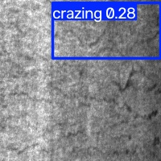

# 工业数据分析与挖掘项目正式报告

**基于 XJTU-SY 轴承振动与 NEU-DET 表面缺陷的智能诊断、检测与工业智能体实践**

| 项目 | 内容 |
| --- | --- |
| 课程 | 工业数据分析与挖掘综合实训 |
| 班级 | 工业互联网技术 23 级　互联2313 |
| 姓名 | 孙勇 |
| 实训周期 | 2026-11-02 ～ 2026-11-19 |
| 数据规模 | XJTU-SY 9216 个振动 CSV；NEU-DET 1800 张灰度图像、6 类缺陷 |
| 代码位置 | 本仓库 `src/`、`agent-visualization/` |
| 运行环境 | macOS（Apple M5，arm64），Python 3.13.12，PyTorch 2.15.0，Node 25 |

> 数据真实性说明：本报告中的模型指标、训练轮数、耗时与分类别结果均来自本机对真实数据集的完整运行，原始记录见 `results/` 与 `results/logs/`。凡属验证集口径、对照实验或尚未接入生产链路的模块，文中均明确标注，不以测试集口径冒充验证集结果。

---

## 目录

1. 项目概述
2. 项目架构
3. 主要技术栈
4. 人工智能相关算法
5. YOLO 的作用
6. YOLO 的训练过程
7. YOLO 的性能展示
8. 系统测试与复现
9. 结论
10. 附录

---

## 1 项目概述

### 1.1 项目背景

工业设备与产品质量分析通常包含两条互补的数据链路：其一是设备运行状态数据，例如滚动轴承的振动信号；其二是产品外观数据，例如热轧带钢表面的缺陷图像。前者关注"设备何时退化、退化到什么程度、还能运行多久"，后者关注"产品是否存在缺陷、缺陷在哪里、属于哪一类"。

本项目以两条真实工业数据线为对象，完成从数据探索、特征工程、模型训练、评估调优到智能体集成的完整闭环：

- **设备运维线**：基于 XJTU-SY 轴承加速寿命数据，完成健康阶段识别、故障分类与剩余寿命（RUL）预测，并封装为可对话的运维诊断智能体。
- **表面质检线**：基于 NEU-DET 金属表面缺陷数据，完成六类缺陷的图像分类、目标检测与调优消融，并封装为带台账、查询、预警与工艺知识检索的视觉质检智能体。
- **智能体集成线**：将上述能力整合为统一 CLI 智能体，并额外实现一个 TypeScript Web 可视化智能体，用自然语言分析实训结果、按需生成图表。

### 1.2 数据来源与规模

**表 1-1　XJTU-SY 轴承数据集**

| 项目 | 内容 |
| --- | --- |
| 来源 | 西安交通大学与 Sumyoung 公司联合发布的滚动轴承加速寿命试验数据 |
| 规模 | 3 种工况（2100/2250/2400 rpm，对应 12/11/10 kN）× 每工况 5 个轴承，共 15 套全寿命数据、9216 个 CSV |
| 采样 | 水平、垂直两路加速度计，采样频率 25.6 kHz；每分钟采集 1.28 s，每文件 32768 点 |
| 轴承参数 | LDK UER204：滚珠数 Z=8，球径 d=7.92 mm，中径 D=34.55 mm，接触角 α=0° |
| 本项目用法 | 全量特征表 9216 行，按轴承留出评估，避免相邻文件泄漏 |

**表 1-2　NEU-DET 金属表面缺陷数据集**

| 项目 | 内容 |
| --- | --- |
| 来源 | 东北大学热轧带钢表面缺陷数据集 |
| 规模 | 1800 张 200×200 灰度图，6 类各 300 张；检测版提供矩形框标注 |
| 类别 | crazing 龟裂、inclusion 夹杂、patches 斑块、pitted_surface 麻点、rolled_in_scale 氧化铁皮压入、scratches 划痕 |
| 项目用法 | 分类任务采用 8:1:1 分层划分；检测任务采用按类别分层的 8:2 训练/验证划分 |

### 1.3 建设目标

1. 建立可复现的工业数据分析流水线，覆盖数据加载、特征提取、模型训练、评估与结果落盘。
2. 在轴承数据上完成传统机器学习与深度学习对照，明确跨轴承泛化的真实水平。
3. 在 NEU-DET 上完成图像分类与目标检测，比较分类模型与检测模型的能力边界。
4. 将模型封装为具备工具调用、记忆、检索、预警与自然语言交互能力的智能体。
5. 通过统一入口与 Web 可视化界面，降低模型结果的使用门槛。

### 1.4 主要成果

| 任务 | 代表方法 | 主要结果 |
| --- | --- | --- |
| 轴承健康阶段三分类 | 手工特征 + RandomForest | 测试准确率 0.7820，macroF1 0.7202 |
| 轴承剩余寿命回归 | GradientBoosting | 测试 MAE 0.2615，RMSE 0.3013 |
| 表面缺陷六分类 | ResNet18 迁移学习 | 测试准确率 0.9944，macroF1 0.9944 |
| 表面缺陷六分类 | EfficientNet-B0 迁移学习 | 测试准确率 0.9889，macroF1 0.9889 |
| 表面缺陷检测 | YOLOv8n 预训练微调 | 验证集 mAP50 0.7703，mAP50-95 0.4362 |
| 运维诊断智能体 | IsolationForest + 分类/RUL + 包络谱 + LLM | 可完成异常判定、阶段识别、元件定位与报告生成 |
| 视觉质检智能体 | ResNet18 + SQLite + TF-IDF RAG + 连续预警 | 可完成检测入库、自然语言查询、工艺原因检索与二级预警 |
| 可视化智能体 | React + ECharts + OpenAI 兼容接口 | 在线模型自由问答，按需生成 7 类图表，支持 CSV 上传 |

---

## 2 项目架构

### 2.1 设计原则

项目采用"**算法内核 + 智能体外壳**"的双线组织方式，核心原则如下：

1. **同一份数据、同一套标签口径**：第 1 周产出的 `results/week1/features.csv` 是后续深度学习与运维智能体的共同输入，避免各实验各自构造标签。
2. **公共能力下沉**：数据加载、特征提取、训练循环、图像增强、绘图与路径处理集中在 `src/common/`，各周脚本只保留实验逻辑。
3. **评估口径优先**：轴承任务默认按轴承留出，图像分类采用分层 8:1:1 划分；所有结果同时保留交叉验证与留出测试两组数字，避免用泄漏口径夸大效果。
4. **可复现与可降级**：随机种子固定为 42，超参数与划分落盘；智能体在线模型不可用时先询问用户，确认后才使用同结构离线模板。
5. **模型即工具**：智能体不重复训练模型，而是把已落盘的分类、回归、检测模型封装为工具，由对话层或路由层编排。

### 2.2 总体分层架构

```text
┌──────────────────────────────────────────────────────────────────────┐
│ 应用层                                                               │
│  agent-maintenance（运维诊断）  agent-inspection（视觉质检）           │
│  agent-unified（统一路由 + 对话）  agent-visualization（Web 可视化）  │
├──────────────────────────────────────────────────────────────────────┤
│ 智能体能力层                                                         │
│  异常检测 · 阶段分类 · RUL 回归 · 包络定位 · 视觉分类 · 台账记忆       │
│  自然语言查询 · 连续缺陷预警 · TF-IDF RAG · LLM 报告 · 图表规格生成    │
├──────────────────────────────────────────────────────────────────────┤
│ 模型层                                                               │
│  models/week1_classifier.joblib · week1_rul.joblib                    │
│  models/resnet18_neu.pth · efficientnet_b0_neu.pth                    │
│  results/week2_3/yolo/train/weights/best.pt                           │
├──────────────────────────────────────────────────────────────────────┤
│ 算法内核层                                                           │
│  week1-bearing-ml：特征工程 + RF/SVM/KNN/LR + RUL 回归                │
│  week2-bearing-dl：RNN / LSTM / 1D-CNN / LSTM-RUL                    │
│  week2-3-surface-defect：ResNet / EfficientNet / YOLOv8n / 消融       │
├──────────────────────────────────────────────────────────────────────┤
│ 公共层                                                               │
│  common/bearing.py · features.py · dl.py · cv.py · neu.py             │
│  plotting.py · synthesize.py · confirm.py                             │
├──────────────────────────────────────────────────────────────────────┤
│ 数据层                                                               │
│  data/XJTU-SY_Bearing_Datasets/（工况/轴承/CSV）                      │
│  data/NEU-DET/（分类或 VOC 布局） · data/NEU-DET-yolo/（检测布局）     │
└──────────────────────────────────────────────────────────────────────┘
```

### 2.3 目录与模块职责

```text
.
├── src/
│   ├── common/                  # 数据发现、特征提取、训练公共件、CV 工具、合成数据
│   ├── week1-bearing-ml/        # 探索、特征、相关性、传统分类、RUL 回归
│   ├── week2-bearing-dl/        # PyTorch 环境、RNN、LSTM、1D-CNN、LSTM-RUL
│   ├── week2-3-surface-defect/  # NEU 探索、ResNet、EfficientNet、YOLO、消融
│   ├── agent-maintenance/       # 运维诊断智能体
│   ├── agent-inspection/        # 视觉质检智能体（SQLite + RAG + 预警）
│   └── agent-unified/           # 统一入口：路由 + 工具编排 + 基础对话
├── agent-visualization/         # TypeScript Web 可视化智能体
├── data/                        # 数据集布局说明（大文件不入库）
├── models/                      # 训练权重（不入库，按脚本生成）
├── results/                     # 实验结果、图表、日志、YOLO 训练产物
├── scripts/smoke_test.sh        # 合成小数据全链路自检
├── config/                      # 轴承几何参数等配置
├── docs/                        # 实训指南与规划
├── 实训手册/                    # 每日记录
└── 实训报告/                    # 本报告
```

**表 2-1　核心模块职责**

| 模块 | 职责 |
| --- | --- |
| `common/bearing.py` | 数据集扫描、CSV 读取、轴承几何参数与故障特征频率计算 |
| `common/features.py` | 时域 11 维、频域 8 维、包络谱 5 维，双通道共 48 维，并补充 `rms_mean` |
| `common/dl.py` | 设备选择、原始序列滑窗与标准化、通用训练/评估循环 |
| `common/cv.py` | 图像数据集、ImageNet 归一化、ResNet18/EfficientNet-B0 构建、Focal Loss、分类训练循环 |
| `common/neu.py` | NEU-DET 布局识别、VOC→YOLO 标注转换、分层划分、dataset YAML 生成 |
| `week1-bearing-ml/` | 从探索到特征、相关性、分类与 RUL 的五个按日脚本 |
| `week2-bearing-dl/` | 以原始振动序列为输入的 RNN/LSTM/CNN 对照与 LSTM-RUL |
| `week2-3-surface-defect/` | NEU-DET 分类、检测、调优消融与标注格式转换 |
| `agent-maintenance/` | 异常检测、诊断链路、报告渲染、大模型接入、CLI 对话 |
| `agent-inspection/` | 视觉推理工具、SQLite 台账、查询、RAG、预警、CLI 对话 |
| `agent-unified/` | 意图路由、工具调用、带上下文对话 |
| `agent-visualization/` | React 前端、Express 后端、在线模型调用、图表规格校验与 ECharts 渲染 |

### 2.4 数据流设计

**轴承数据流**

```text
XJTU-SY CSV（两通道 32768 点）
  → 按工况/轴承/文件序号发现
  → 时域/频域/包络谱特征提取
  → features.csv（56 列：48 维特征 + rms_mean + 7 列元数据）
  → 健康阶段标签（健康/退化/故障）与 rel_rul
  → 按轴承留出划分
  → RF/SVM/KNN/LR 或 RNN/LSTM/CNN/LSTM-RUL
  → 模型落盘 models/
  → 运维诊断智能体加载为工具
```

**图像数据流**

```text
NEU-DET 原始图像与标注
  ├── 分类布局：六类文件夹 → 分层 8:1:1 → ResNet18 / EfficientNet-B0
  └── VOC 标注 → convert_voc_to_yolo.py → images/{train,valid} + labels
      → 按类别分层 8:2 → YOLOv8n 微调 → best.pt → 验证与预测可视化
```

**智能体数据流**

```text
用户自然语言
  → 意图识别/路由
  → 调用工具（模型推理、台账查询、RAG 检索、图表规格生成）
  → 结构化证据
  → 大模型组织回答（或离线模板，经用户确认）
  → 终端/浏览器输出
```

### 2.5 智能体架构

**（1）设备运维诊断智能体**

```text
振动 CSV
  → IsolationForest 异常检测（健康期样本训练，contamination=0.05）
  → week1 分类模型判健康阶段
  → week1 RUL 模型估计相对剩余寿命
  → 希尔伯特包络谱在 BPFO/BPFI/BSF/FTF 附近取峰，定位疑似故障元件
  → DeepSeek 生成结构化报告（结论、证据链、处置建议、监测计划）
  → CLI：/scan /report /ask
```

**（2）视觉质检智能体**

```text
图像
  → ResNet18 分类工具输出类别与置信度
  → SQLite 台账记录（时间、机台、图像路径、类别、置信度）
  → 自然语言查询转为台账统计（缺陷排行、机台趋势、类别计数）
  → 连续 ≥3 次同类缺陷触发二级预警
  → TF-IDF 字符 n-gram 检索工艺文件，返回疑似工艺原因与处置建议
```

**（3）统一智能体**

`agent-unified/` 用规则路由把自然语言分派到运维诊断、视觉质检或普通对话。路由优先识别路径与文件类型：`.csv` 进入运维链路，图片进入质检链路；随后用关键词区分报告、查询、预警、RAG 与普通问答。基础对话保留最近 12 条消息，并把最近一次工具结果带入上下文。

**（4）Web 可视化智能体**

```text
React + Vite（web/）
  → POST /api/chat { datasetId, question, history }
  → Express（server/index.ts）
      ├── datasets.ts：CSV 读取、字段画像、内置数据集、上传缓存
      ├── llm.ts：数据画像 + 最近 8 轮对话 → 自由文字 + 可选图表规格
      └── chart.ts：筛选、聚合、分组、分位数 → ECharts option
  → 在线模型（DeepSeek，OpenAI 兼容接口）
  → 前端渲染文字与图表，可导出 PNG
```

该智能体为纯在线模式：未配置密钥返回 503，模型调用失败返回 502；不提供本地规则引擎，也不把固定模板伪装成模型回答。图表规格经过 zod 校验，字段必须真实存在、y 必须为数值列；不合法时本次只返回文字回答。

### 2.6 关键工程设计

| 设计点 | 做法 | 目的 |
| --- | --- | --- |
| 评估防泄漏 | 轴承按轴承留出；图像分类分层 8:1:1；检测分层 8:2 | 避免相邻文件或同图重复造成虚高 |
| 数据布局兼容 | `detect_layout()` 识别分类、YOLO、VOC 三种布局 | 减少人工整理数据的成本 |
| 预训练降级 | 权重下载失败时自动改为随机初始化，并保留对照实验 | 保证断网环境仍可运行 |
| 智能体降级 | 在线模型失败时先询问，确认后才走离线模板 | 不静默伪造模型输出 |
| 密钥安全 | 密钥仅存在服务端 `.env`，前端不接触 | 防止 API key 泄漏 |
| 全链路自检 | `scripts/smoke_test.sh` 用合成小数据跑通 18 个入口 | 交付前快速发现环境或接口损坏 |
| 结果可追溯 | 指标写 CSV/JSON，终端输出写日志，图表落盘 | 报告数字可回查 |

---

## 3 主要技术栈

### 3.1 技术栈总览

| 层次 | 技术 | 版本/说明 | 用途 |
| --- | --- | --- | --- |
| 编程语言 | Python | 3.13.12 | 数据分析、机器学习、深度学习、智能体 |
| 编程语言 | TypeScript | 7.0.2 | Web 可视化智能体前后端 |
| 数据计算 | NumPy / SciPy / pandas | 2.5.4 / 1.18.1 / 3.1.0 | 数组运算、信号处理、表格处理 |
| 传统机器学习 | scikit-learn | 1.9.1 | 划分、标准化、RF/SVM/KNN/LR、指标 |
| 模型持久化 | joblib | 1.6.0 | 分类与回归模型落盘 |
| 深度学习 | PyTorch | 2.15.0 | RNN/LSTM/CNN、ResNet/EfficientNet 训练 |
| 视觉骨干 | torchvision | 0.29.2 | ImageNet 预训练模型与图像变换 |
| 目标检测 | Ultralytics YOLOv8 | 8.4.198 | 缺陷检测训练、验证与预测 |
| 可视化 | Matplotlib | 3.11.2 | 训练曲线、混淆矩阵、消融热力图 |
| 智能体存储 | SQLite | Python 标准库 | 质检台账记忆 |
| 检索 | TF-IDF 字符 n-gram | scikit-learn | 工艺文件 RAG |
| 大模型 | DeepSeek API | OpenAI 兼容 `/chat/completions` | 报告生成、自由问答、图表规划 |
| 前端 | React / Vite | 19.3.1 / 8.3.5 | 可视化智能体界面 |
| 图表 | ECharts | 6.1.0 | 交互式图表渲染与 PNG 导出 |
| 后端 | Express / zod / multer | 5.3.0 / 4.6.7 / 2.x | API、参数校验、CSV 上传 |
| 运行环境 | macOS Apple M5 | arm64，CPU/MPS | 全部实验在本机完成 |
| 构建与检查 | TypeScript / Vite / shell | `tsc --noEmit`、`npm run build`、`smoke_test.sh` | 类型检查、生产构建、链路自检 |

### 3.2 Python 数据与机器学习栈

- **NumPy/SciPy**：完成振动信号读取、FFT、希尔伯特变换、统计量与分位数计算。
- **pandas**：维护特征表、指标表与预测结果，统一 UTF-8-SIG 输出，便于 Excel 查看。
- **scikit-learn**：提供 `StandardScaler`、`Pipeline`、`RandomForestClassifier`、`SVC`、`KNeighborsClassifier`、`LogisticRegression`、`GradientBoostingRegressor`、`IsolationForest`、`TfidfVectorizer` 以及分类/回归指标。
- **joblib**：保存最优分类器、RUL 模型、特征清单与类别表，供智能体直接加载。

### 3.3 深度学习与计算机视觉栈

- **PyTorch**：统一设备选择（CUDA → MPS → CPU），实现 RNN/LSTM/1D-CNN 与图像分类训练循环。
- **torchvision**：加载 ResNet18、EfficientNet-B0 的 ImageNet 预训练权重，替换分类头完成六类微调。
- **Ultralytics**：YOLOv8n 的训练、验证、预测与曲线绘制；支持预训练权重下载失败时自动从零训练。
- **Matplotlib**：生成训练曲线、混淆矩阵、预测-真值散点图与学习率×损失热力图。

### 3.4 智能体与大模型栈

- **DeepSeek API**：通过 OpenAI 兼容接口调用，服务端保管密钥；运维报告与统一对话共用同一套事实约束。
- **TF-IDF RAG**：使用 `char_wb` 1–3 gram，中文免分词；语料为 7 份模拟工艺文件，检索结果用于解释缺陷成因。
- **SQLite**：保存检测记录，支持按机台、类别、时间统计与连续缺陷判断。
- **规则路由**：统一智能体用正则与关键词识别路径、机台号、工况和任务类型，避免把所有请求都交给大模型。

### 3.5 Web 技术栈

- **React 19 + Vite 8**：组件化界面与快速热更新。
- **ECharts 6**：折线、柱状、散点、箱线、热力、饼图、直方图七类图表。
- **Express 5 + TypeScript**：REST API、CSV 上传、数据画像与图表构建。
- **zod**：校验在线模型返回的图表规格，拒绝不存在的字段和非数值 y。
- **dotenv**：从 `agent-visualization/.env` 或项目根目录 `.env` 读取密钥，优先级明确。

### 3.6 实验环境说明

本机为 macOS Apple M5（arm64），PyTorch 使用 CPU/MPS。YOLO 训练在当前环境中以 CPU 完成，30 个 epoch 共耗时 2.382 小时，日志中 `GPU_mem` 为 0G。NVIDIA 机器可按实训指南安装 CUDA 版 PyTorch；脚本通过命令行参数指定数据与输出目录，不依赖固定路径。

---

## 4 人工智能相关算法

### 4.1 算法总览

| 任务 | 算法 | 输入 | 输出 | 主要指标 |
| --- | --- | --- | --- | --- |
| 轴承异常检测 | Isolation Forest | 健康期手工特征 | 异常分/异常标记 | 异常分、人工复核 |
| 轴承健康阶段分类 | RandomForest / SVM-RBF / KNN / LogisticRegression | 49 维数值特征 | 健康/退化/故障 | 准确率、macroF1、混淆矩阵 |
| 轴承健康阶段分类 | RNN / LSTM / 1D-CNN | 256 点原始振动序列 | 三分类 | 准确率、macroF1 |
| 剩余寿命预测 | RandomForest / GradientBoosting / LSTM | 手工特征或滑窗序列 | 相对 RUL | MAE、RMSE、R² |
| 表面缺陷分类 | ResNet18 / EfficientNet-B0 | 200×200 灰度图 | 六类缺陷 | 准确率、macroF1、混淆矩阵 |
| 表面缺陷检测 | YOLOv8n | 640×640 图像 | 边界框 + 类别 + 置信度 | P、R、mAP50、mAP50-95 |
| 工艺知识问答 | TF-IDF 字符 n-gram | 自然语言问题 | 相关工艺片段 | 检索相似度 |
| 报告与问答 | DeepSeek 大模型 | 结构化证据 + 问题 | 自然语言报告 | 事实一致性、人工评估 |
| 图表生成 | 大模型 + zod + ECharts | 数据画像 + 问题 + 历史 | 文字回答 + 图表规格 | 规格合法性、渲染成功率 |

### 4.2 振动信号特征工程

每个 CSV 含水平、垂直两路振动信号。对每路信号提取 24 维特征，双通道共 48 维，再补充双通道 RMS 均值 1 维，构成 49 维数值特征；特征表共 56 列，另含工况、轴承、文件序号、阶段、相对 RUL 等 7 列元数据。项目文档中有时以"50 维特征"简称，实际以 49 维数值特征为准。

**表 4-1　单通道特征组成**

| 类别 | 维度 | 特征 |
| --- | --- | --- |
| 时域 | 11 | 均值、标准差、RMS、峰值、峰峰值、峭度、偏度、峰值因子、裕度因子、波形因子、脉冲因子 |
| 频域 | 8 | 重心频率、均方根频率、频率标准差、谱峭度、四个频带能量占比（0–1k、1–4k、4–8k、8–12.8k Hz） |
| 包络谱 | 5 | 包络 RMS，以及 BPFO、BPFI、BSF、FTF 四个故障特征频率附近的谱峰 |

关键公式：

```text
RMS = sqrt( (1/N) * Σ xi² )

Kurtosis = E[(x - μ)^4] / σ^4

Hilbert 包络：
  xa(t) = x(t) + j·H[x(t)]
  A(t)  = |xa(t)|

故障特征频率（α 为接触角，fr 为转频）：
  BPFO = (Z/2)·fr·(1 - d/D·cosα)
  BPFI = (Z/2)·fr·(1 + d/D·cosα)
  BSF  = (D/(2d))·fr·(1 - (d/D·cosα)²)
  FTF  = (fr/2)·(1 - d/D·cosα)
```

包络谱特征在理论频率 ±3% 窗口内取峰，以容忍转差与滑差。

**标签构造**：

- 健康阶段：以每轴承前 20% 文件 RMS 中位数为健康基线；RMS ≤ 1.5 倍基线记为健康（0），1.5–3 倍记为退化（1），大于 3 倍记为故障（2）。
- 相对剩余寿命：`rel_rul = (N - i) / N`，其中 `N` 为该轴承文件总数，`i` 为当前文件序号。

### 4.3 传统机器学习分类

四个模型统一采用 `StandardScaler + 分类器` 的 Pipeline，使用 5 折交叉验证与按轴承留出测试。按测试 macroF1 选择 RandomForest 入库。

**表 4-2　轴承健康阶段三分类结果（Top-20 特征，按轴承留出）**

| 模型 | CV 准确率 | 测试准确率 | 测试 macroF1 |
| --- | --- | --- | --- |
| RandomForest | 0.9936 ± 0.0029 | 0.7820 | 0.7202 |
| SVM-RBF | 0.9937 ± 0.0031 | 0.4541 | 0.3926 |
| KNN | 0.9931 ± 0.0019 | 0.7122 | 0.6264 |
| LogisticRegression | 0.9642 ± 0.0051 | 0.8950 | 0.6690 |

分析：交叉验证分数接近 0.99，而留出轴承测试明显下降，说明同一轴承内相邻文件高度相关，随机划分会产生泄漏。LogisticRegression 的准确率最高，但 macroF1 低于 RandomForest，说明其少数类识别能力较弱；因此最终选择 RandomForest。

### 4.4 深度学习序列模型

RNN、LSTM、1D-CNN 共享同一条数据管道：按 `file_path` 映射回原始 CSV，取垂直通道并降采样到 256 点，逐序列 z-score 标准化。网络末步隐状态或池化特征接全连接三分类，Adam 学习率 1e-3，batch 64。

**表 4-3　原始序列模型对比（同数据同划分）**

| 模型 | 输入 | 测试准确率 | 测试 macroF1 | 现象 |
| --- | --- | --- | --- | --- |
| RandomForest + Top-20 特征 | 手工特征 | 0.7820 | 0.7202 | 三类均有召回 |
| 1D-CNN | 256 点原始序列 | 0.8169 | 0.3143 | 召回塌缩到多数类 |
| LSTM | 256 点原始序列 | 0.8347 | 0.3033 | 几乎全部判为健康 |
| RNN | 256 点原始序列 | 0.8347 | 0.3033 | 与 LSTM 同样塌缩 |

LSTM 与 RNN 的准确率 0.8347 恰好等于测试集中健康类占比（2630/3151），说明模型并未学到跨轴承的退化判别能力。报告保留这一负面对照，并以 macroF1 作为主要选择依据。

### 4.5 剩余寿命回归

RUL 目标为 `rel_rul ∈ (0, 1]`。RandomForest 与 GradientBoosting 使用手工特征；LSTM-RUL 使用每轴承按文件顺序构造的滑窗（W=8，Top-20 特征），预测窗口末文件的相对 RUL。

**表 4-4　RUL 回归结果（按轴承留出）**

| 模型 | 测试 MAE | 测试 RMSE | 测试 R² |
| --- | --- | --- | --- |
| RandomForest | 0.2834 | 0.3316 | -0.3191 |
| GradientBoosting | 0.2615 | 0.3013 | -0.0891 |
| LSTM（W=8） | 0.3977 | 0.4845 | -1.8533 |

交叉验证 MAE 分别为 0.0523 与 0.0893，但留出轴承上 R² 转负。结论是模型可以拟合单轴承内部退化趋势，但绝对幅值特征受工况、装配与个体差异影响，跨轴承迁移困难。

### 4.6 图像分类

ResNet18 与 EfficientNet-B0 均采用 ImageNet 预训练权重，替换分类头后进行六类微调。输入灰度图先 `convert("L").convert("RGB")` 对齐三通道，再按 ImageNet 均值与标准差归一化；训练增强包括随机水平翻转与 ±10° 旋转。验证集准确率最高的权重被保存，最后在测试集上评估。

**表 4-5　NEU-DET 六分类结果（分层 8:1:1，180 张测试图）**

| 骨干 | 参数量 | 测试准确率 | macroF1 | 单 epoch 耗时 |
| --- | --- | --- | --- | --- |
| ResNet18 | 11.7M | 0.9944 | 0.9944 | 12.9 s |
| EfficientNet-B0 | 5.3M | 0.9889 | 0.9889 | 23.2 s |

对照实验：

- ResNet18 随机初始化从零训练仅 0.8944，迁移学习提升约 10 个百分点。
- EfficientNet-B0 参数量更少，准确率低 0.55 个百分点，但在本机 MPS 上单 epoch 反而慢约 1.8 倍。
- 两组各 180 张测试图，0.9944 与 0.9889 实际只差 1 张，差异不宜过度解读。

### 4.7 学习率与损失函数消融

ResNet18 在统一设置（160 px、6 epochs、batch 32、seed 42）下做 3×3 网格实验，损失函数包括交叉熵（CE）、CE + 标签平滑 0.1、Focal Loss（γ=2）。

**表 4-6　消融实验测试准确率**

| 学习率 \ 损失 | CE | CE+LS 0.1 | Focal γ=2 |
| --- | --- | --- | --- |
| 1e-2 | 0.7611 | 0.6000 | 0.5222 |
| 1e-3 | 0.9833 | 0.9944 | 0.9889 |
| 1e-4 | 0.9889 | 1.0000 | 1.0000 |

学习率 1e-2 明显过大；在合适学习率下，标签平滑与 Focal Loss 的边际收益为 0.5–1.7 个百分点。数据接近饱和时，继续调损失的收益有限。

### 4.8 异常检测、RAG 与大模型

- **Isolation Forest**：以健康期样本训练，`contamination=0.05`。异常分越低越异常。实测 Bearing1_1/123.csv 异常分 -0.1872，判为故障，包络证据指向外圈；留出轴承 Bearing2_3/533.csv 异常分 -0.1886，指向内圈，均与真实失效形式一致。
- **TF-IDF RAG**：`char_wb` 1–3 gram，中文免分词；7 份模拟工艺文件作为语料。检索命中后返回文件片段与相似度，供质检智能体解释缺陷成因。
- **DeepSeek 大模型**：运维报告与统一对话共用事实约束提示词，要求结论、证据链与建议只能来自输入事实，不得编造数值。在线失败时先询问用户，确认后才使用同结构离线模板。
- **Web 可视化智能体**：在线模型返回 `{reply, chart}`，`chart` 可为空。服务端用 zod 校验字段是否存在、y 是否为数值列，再做筛选、聚合、分组与分位数计算，最后生成 ECharts option。

### 4.9 评估指标定义

```text
Precision = TP / (TP + FP)
Recall    = TP / (TP + FN)
AP        = P-R 曲线下的面积
mAP50     = IoU=0.5 时各类 AP 的平均值
mAP50-95  = IoU 从 0.50 到 0.95、步长 0.05 共 10 个阈值下 mAP 的平均值
MAE       = (1/n) Σ |ŷi - yi|
RMSE      = sqrt( (1/n) Σ (ŷi - yi)² )
R²        = 1 - Σ(ŷi - yi)² / Σ(yi - ȳ)²
```

---

## 5 YOLO 的作用

### 5.1 分类与检测的能力差异

图像分类模型对整张图输出一个类别，例如"这张图是龟裂"，但无法回答缺陷在图像中的位置，也无法处理一张图包含多个缺陷实例的情况。目标检测模型同时输出：

```text
边界框（x1, y1, x2, y2）+ 类别 + 置信度
```

因此检测模型更适合产线质检中的"定位—计数—分级"任务：

- 指出缺陷位置，便于裁切复核与工艺追溯；
- 一张图可输出多个缺陷框，适配多缺陷共存；
- 置信度可用于设置不同等级的报警阈值；
- 检测框数量与面积可进一步统计缺陷密度。

### 5.2 YOLO 在本项目中的定位

本项目中的 YOLOv8n 承担三项作用：

1. **检测能力验证**：在 NEU-DET 六类缺陷上完成端到端训练与验证，证明单阶段检测器可以在小样本工业缺陷数据上取得可用的 mAP。
2. **结果可视化与汇报展示**：输出验证集预测图、PR 曲线、F1 曲线、混淆矩阵与训练曲线，为报告和答辩提供直观证据。
3. **技术储备与扩展接口**：YOLO 的检测结果已作为实训结果数据集接入 Web 可视化智能体，统一智能体的项目问答也会引用 YOLO 指标。后续可将 `best.pt` 接入视觉质检智能体，替换或补充当前基于 ResNet18 的分类推理。

需要明确的是：**当前 `agent-inspection` 的默认推理模型是 ResNet18 分类模型，YOLO 尚未接入该智能体的在线检测链路**。因此本报告不把 YOLO 描述为质检智能体已经在用的检测器，而是把它定位为检测实验、性能展示与后续集成基础。这一区分避免了"实验指标"与"系统实际能力"混淆。

### 5.3 为什么选择 YOLOv8n

- **单阶段、速度快**：YOLO 在一次前向中完成分类与回归，适合产线在线检测。
- **工程成熟**：Ultralytics 提供训练、验证、预测、曲线绘制与权重导出的一体化接口，复现成本低。
- **轻量版本适合小数据**：YOLOv8n 仅约 3.01M 参数、8.2 GFLOPs，在 CPU 上也能完成 30 epoch 训练，适合课程实训环境。
- **迁移学习友好**：COCO 预训练权重提供通用边缘与纹理特征，在小规模工业缺陷数据上比从零训练更稳。

---

## 6 YOLO 的训练过程

### 6.1 数据准备

**（1）数据来源与类别**

NEU-DET 检测版以 VOC 形式发布，包含 `ANNOTATIONS/` 与 `IMAGES/`（或标准 VOC 的 `Annotations/` 与 `JPEGImages/`）。共 1800 张 200×200 灰度图，6 类各 300 张。

**（2）VOC 转 YOLO**

转换脚本 `src/week2-3-surface-defect/convert_voc_to_yolo.py` 完成以下工作：

1. 解析每张图对应的 XML，读取图像宽高与每个目标的 `xmin/ymin/xmax/ymax`；
2. 将类别名统一小写、空格或连字符转下划线，并映射到固定类别下标；
3. 将 VOC 绝对坐标转换为 YOLO 归一化中心点格式：

```text
xc = (xmin + xmax) / (2W)
yc = (ymin + ymax) / (2H)
w  = (xmax - xmin) / W
h  = (ymax - ymin) / H
```

4. 写入 `labels/<split>/<stem>.txt`，同时复制图像到 `images/<split>/`；
5. 按类别分层划分训练/验证集，默认 `val_ratio=0.2`、`seed=42`，避免某类缺陷在验证集中缺失。

**（3）划分结果**

**表 6-1　YOLO 数据集划分与标注统计**

| 划分 | 图像数 | 标注框数 | 每类图像数 | 说明 |
| --- | --- | --- | --- | --- |
| train | 1440 | 3360 | 每类 240 | 用于梯度更新 |
| valid | 360 | 828 | 每类 60 | 用于验证与模型选择 |
| test | 0 | 0 | 0 | 当前未生成独立测试划分 |

验证集 828 个标注框中，扫描阶段自动移除了 1 个重复标注；训练集移除了 2 个重复标注。当前所有 YOLO 指标均为 **valid 验证集口径**，不是独立 test 集口径，报告中不将其称为测试集结果。

### 6.2 模型结构

YOLOv8n 由三部分组成：

- **Backbone**：Conv + C2f 模块堆叠，末端使用 SPPF 扩大感受野，提取多尺度纹理与边缘特征。
- **Neck**：PAN-FPN 结构，自顶向下与自底向上双向融合 P3/P4/P5 三层特征。
- **Head**：解耦的无锚框检测头，分别输出分类分支与边界框回归分支，并使用分布焦点损失（DFL）建模框位置分布。

本次训练日志中的模型摘要：

```text
129 layers
3,012,018 parameters
3,012,002 gradients
8.2 GFLOPs
检测头：Detect [6, 16, None, [64, 128, 256]]
```

将 COCO 的 80 类检测头替换为 6 类后，迁移了 349/355 个权重项；`model.22.dfl.conv.weight` 被冻结。

### 6.3 训练配置

**表 6-2　YOLOv8n 训练超参数**

| 参数 | 取值 | 说明 |
| --- | --- | --- |
| 模型 | `yolov8n.pt` | COCO 预训练权重微调 |
| 输入尺寸 | 640×640 | 兼顾小目标与显存/内存 |
| batch | 16 | CPU 环境可承受 |
| epochs | 30 | 全程训练，无早停 |
| 优化器 | AdamW（auto） | 日志解析为 lr=0.001，momentum=0.9 |
| 权重衰减 | 0.0005 | 抑制过拟合 |
| 学习率策略 | 余弦/线性衰减，lrf=0.01 | 最终学习率为初始的 1% |
| 随机种子 | 42 | 可复现 |
| 损失权重 | box=7.5，cls=0.5，dfl=1.5 | 回归、分类、分布焦点损失 |
| IoU 阈值 | 0.7 | 训练匹配 |
| Mosaic | 1.0，最后 10 轮关闭 | 提升小目标与上下文多样性 |
| HSV 增强 | h=0.015，s=0.7，v=0.4 | 颜色与亮度扰动 |
| 几何增强 | 水平翻转 0.5，平移 0.1，缩放 0.5 | 不旋转、不剪切、不透视 |
| MixUp/CutMix | 0 | 小数据上易破坏缺陷结构 |
| Erasing | 0.4 | 随机擦除 |
| 自动增强 | RandAugment | Ultralytics 默认策略 |
| 验证 | 每轮结束后验证 | 保存 `best.pt` 与 `last.pt` |
| 设备 | CPU（Apple M5） | 日志 GPU_mem=0G |

### 6.4 训练流程

```text
1. 准备 VOC 版 NEU-DET
2. 运行 convert_voc_to_yolo.py：
     按类别分层划分 train/valid，生成 images/ 与 labels/
3. 运行 make_dataset_yaml()：
     写入 path、train、val、test 与 names
4. 运行 04_yolo_detect.py：
     YOLO("yolov8n.pt") 加载预训练权重
     若下载失败，自动改用 YOLO("yolov8n.yaml") 从零训练
5. model.train(...)：
     30 epochs × 90 iterations（1440 / batch 16）
6. 每轮验证：
     计算 P、R、mAP50、mAP50-95，保存最优权重
7. model.val(data=yaml)：
     在 best.pt 上复算最终指标
8. 选 3 张验证图预测：
     conf=0.25，保存可视化结果
9. 写出 yolo_results.csv 与训练日志
```

复现命令：

```bash
# 1) VOC → YOLO（默认 val_ratio=0.2, seed=42）
.venv/bin/python src/week2-3-surface-defect/convert_voc_to_yolo.py \
  --neu-dir data/NEU-DET --out data/NEU-DET-yolo

# 2) YOLOv8n 微调
.venv/bin/python src/week2-3-surface-defect/04_yolo_detect.py \
  --neu-dir data/NEU-DET-yolo --epochs 30 --imgsz 640 --batch 16

# 3) 从零训练对照（仅 5 epoch，不作为同口径比较）
.venv/bin/python src/week2-3-surface-defect/04_yolo_detect.py \
  --neu-dir data/NEU-DET-yolo --epochs 5 --from-scratch
```

### 6.5 训练收敛情况

**表 6-3　关键轮次的训练损失与验证指标**

| epoch | box_loss | cls_loss | P | R | mAP50 | mAP50-95 |
| --- | --- | --- | --- | --- | --- | --- |
| 1 | 1.770 | 3.036 | 0.608 | 0.257 | 0.229 | 0.102 |
| 5 | 1.571 | 1.722 | 0.596 | 0.538 | 0.556 | 0.268 |
| 10 | 1.454 | 1.552 | 0.746 | 0.533 | 0.623 | 0.320 |
| 15 | 1.413 | 1.417 | 0.597 | 0.671 | 0.690 | 0.368 |
| 20 | 1.358 | 1.336 | 0.696 | 0.573 | 0.684 | 0.366 |
| 25 | 1.303 | 1.167 | 0.710 | 0.680 | 0.740 | 0.416 |
| 30 | 1.236 | 1.077 | 0.724 | 0.715 | 0.771 | 0.436 |

训练在第 30 轮达到全程最优，未触发早停。30 个 epoch 共耗时 **2.382 小时**（约 2 小时 23 分），平均每轮约 4.8 分钟。


*图 6-1 上半部分为 box/cls/dfl 损失，下半部分为 P、R、mAP50、mAP50-95 随 epoch 的变化。*

### 6.6 验证与预测

验证使用 `best.pt` 在 360 张验证图、828 个标注框上复算：

```text
all  360 images  828 instances
P=0.725  R=0.713  mAP50=0.770  mAP50-95=0.436
```

预测阶段从验证集取前 3 张图，设置 `conf=0.25`，经非极大值抑制后输出边界框、类别与置信度，保存到 `results/week2_3/yolo/predict/`。

### 6.7 从零训练对照

为验证预训练权重的价值，额外运行了 5 个 epoch 的随机初始化训练：

| 初始化 | epochs | P | R | mAP50 | mAP50-95 |
| --- | --- | --- | --- | --- | --- |
| 预训练微调 | 30 | 0.725 | 0.713 | 0.770 | 0.436 |
| 从零训练 | 5 | 0.613 | 0.145 | 0.105 | 0.030 |

从零训练仅 5 轮，mAP50 只有 0.105，召回率 0.145，说明在 1440 张训练图的小数据条件下，COCO 预训练特征对收敛速度和最终精度都有明显帮助。由于轮数不同，两组数字不能做严格同口径比较，只能作为趋势对照。

---

## 7 YOLO 的性能展示

### 7.1 总体指标

**表 7-1　YOLOv8n 总体验证指标（valid，360 张图 / 828 个框）**

| 指标 | 数值 | 含义 |
| --- | --- | --- |
| Precision（mP） | 0.7249 | 检出的框中约 72.5% 为正例 |
| Recall（mR） | 0.7134 | 真实缺陷中约 71.3% 被检出 |
| mAP50 | 0.7703 | IoU=0.5 时六类 AP 的平均值 |
| mAP50-95 | 0.4362 | 10 个 IoU 阈值下 mAP 的平均值，更严格 |

mAP50 达到 0.77，说明在宽松定位阈值下模型已具备可用的类别区分与大致定位能力；mAP50-95 降到 0.44，说明高 IoU 下的框回归精度仍是主要瓶颈，尤其是边界模糊的细裂纹。


*图 7-1 六类缺陷的 Precision-Recall 曲线。曲线越靠近右上角，类别检测效果越好。*


*图 7-2 不同置信度阈值下的 F1 曲线，可用于选择产线报警阈值。*

### 7.2 分类别指标

**表 7-2　六类缺陷验证指标**

| 类别 | 标注框数 | P | R | mAP50 | mAP50-95 |
| --- | --- | --- | --- | --- | --- |
| crazing 龟裂 | 141 | 0.617 | 0.320 | 0.418 | 0.137 |
| inclusion 夹杂 | 178 | 0.709 | 0.831 | 0.873 | 0.509 |
| patches 斑块 | 187 | 0.801 | 0.936 | 0.947 | 0.636 |
| pitted_surface 麻点 | 87 | 0.767 | 0.679 | 0.786 | 0.444 |
| rolled_in_scale 氧化铁皮压入 | 121 | 0.608 | 0.636 | 0.666 | 0.343 |
| scratches 划痕 | 114 | 0.848 | 0.877 | 0.931 | 0.547 |
| **全部** | **828** | **0.725** | **0.713** | **0.770** | **0.436** |

**结果分析**

1. **patches 与 scratches 最好**：mAP50 分别为 0.947 与 0.931。这两类缺陷面积较大、纹理或方向特征明显，边界相对清晰，模型容易学习。
2. **crazing 最差**：mAP50 仅 0.418，召回率 0.320。龟裂是细密裂纹，目标小、对比度低、边界模糊，标注框本身也存在主观性；模型容易漏检，或在低置信度下勉强检出。
3. **rolled_in_scale 次差**：mAP50 0.666，精确率 0.608。该类缺陷形态与 patches、inclusion 有相似区域，容易混淆。
4. **类别样本量不均衡**：麻点仅 87 个框，斑块 187 个框，样本量差异会影响各类 AP 的稳定性。
5. **高 IoU 指标普遍偏低**：除 patches 外，其余类别 mAP50-95 均低于 0.55，说明框的紧致度不足，工业场景若要求精确裁切，需要进一步优化定位损失或增加标注一致性。


*图 7-3 验证集混淆矩阵。对角线为正确分类，非对角线显示类别间的混淆关系。*


*图 7-4 按真实类别归一化后的混淆矩阵，便于比较各类召回率。*

### 7.3 验证集预测可视化


*图 7-5 验证集 batch 0 的人工标注示例。*


*图 7-6 同一 batch 的模型预测结果，可用于观察漏检、误检与框位置偏差。*

三张龟裂验证图的预测结果：

| 图像 | 模型输出 | 置信度 | 观察 |
| --- | --- | --- | --- |
| crazing_10.jpg | crazing | 0.28 | 检出裂纹区域，但置信度接近 0.25 阈值 |
| crazing_103.jpg | crazing | 0.27 | 同样处于低置信度区间，说明模型对细裂纹不自信 |
| crazing_104.jpg | patches | 0.51 | 将龟裂误判为斑块，属于典型类别混淆 |




这组样例与分类别指标一致：crazing 的召回和置信度都偏低，是当前模型最薄弱的类别。

### 7.4 与分类模型的关系

YOLO 与 ResNet18/EfficientNet 不是替代关系，而是不同粒度的能力：

| 维度 | 分类模型 | 检测模型 |
| --- | --- | --- |
| 输出 | 整图类别 | 多个边界框 + 类别 + 置信度 |
| 定位 | 无 | 有 |
| 多缺陷 | 不支持 | 支持 |
| 评价 | 准确率、macroF1 | P、R、mAP50、mAP50-95 |
| 本项目结果 | ResNet18 0.9944 | YOLOv8n mAP50 0.7703 |
| 适用场景 | 单缺陷、已裁切图像、快速分级 | 原始产线图、需要定位与计数 |

分类模型的 0.9944 不能与检测模型的 0.7703 直接比较：前者只需判断整图类别，后者还要回归框位置并处理多目标与背景。将两者并列展示时，必须说明任务口径不同。

### 7.5 工程可用性评估

- **模型体积**：`best.pt` 约 6.2 MB，适合边缘端部署与离线拷贝。
- **训练成本**：CPU 30 epoch 约 2.38 小时，说明在无 GPU 的课程环境中仍可完成训练。
- **推理配置**：预测使用 `conf=0.25`，实际产线可按误检成本调整；提高阈值可减少误报，但会进一步降低 crazing 召回。
- **可解释性**：预测图直接显示框、类别与置信度，便于质检人员复核。
- **当前缺口**：尚无独立 test 划分、未做多随机种子与超参数搜索、未测推理延迟与吞吐、未做 TensorRT/ONNX 导出，因此当前结果应视为"课程实验级可用"，而非产线验收级。

### 7.6 局限与改进方向

1. **补充独立测试集**：当前只有 train/valid，建议从每类中再分层留出 10% 作为 test，或采用 5 折交叉验证报告均值与方差。
2. **针对 crazing 增强**：增加细裂纹样本、使用更高输入分辨率（如 960）、引入 Copy-Paste 或针对性裁剪增强，改善小目标与低对比度目标。
3. **提升定位精度**：尝试更大模型（YOLOv8s/m）、调整 box/dfl 损失权重、增加标注一致性检查，提升 mAP50-95。
4. **阈值与业务联合调优**：按漏检成本与误检成本绘制代价曲线，而不是只看固定 0.25 阈值。
5. **模型集成到智能体**：将 `best.pt` 封装为 `VisionTool` 的检测后端，输出框坐标、类别与置信度，写入 SQLite 台账，并与连续缺陷预警联动。
6. **部署优化**：导出 ONNX/TensorRT，测量单图延迟与批处理吞吐；对边缘设备做量化与剪枝评估。
7. **多随机种子复验**：至少运行 3 个 seed，报告 mAP 均值与标准差，避免单次结果偶然性。

---

## 8 系统测试与复现

### 8.1 测试方案

| 测试类型 | 方法 | 结果 |
| --- | --- | --- |
| 全链路冒烟 | `scripts/smoke_test.sh` 用合成小数据跑通 18 个入口脚本 | 18/18 通过，退出码 0 |
| 轴承分类 | 5 折 CV + 按轴承留出 | RF 0.7820 / macroF1 0.7202 |
| 轴承 RUL | 按轴承留出 | GBoost MAE 0.2615 |
| 图像分类 | 分层 8:1:1 | ResNet18 0.9944 |
| 缺陷检测 | 分层 8:2，验证集 | YOLOv8n mAP50 0.7703 |
| 智能体 | 终端实测 + 日志留档 | 运维外圈/内圈定位正确；质检连续划痕触发预警 |
| Web 智能体 | 类型检查、构建、浏览器联调 | `tsc` 通过，`vite build` 通过，图表正常渲染 |

### 8.2 复现命令

```bash
# 环境
python3 -m venv .venv
source .venv/bin/activate
pip install -r requirements.txt

# 第 1 周：轴承传统机器学习
.venv/bin/python src/week1-bearing-ml/01_explore.py
.venv/bin/python src/week1-bearing-ml/02_features.py
.venv/bin/python src/week1-bearing-ml/03_correlation.py
.venv/bin/python src/week1-bearing-ml/04_classify.py
.venv/bin/python src/week1-bearing-ml/05_rul_regression.py

# 第 2 周：轴承深度学习
.venv/bin/python src/week2-bearing-dl/01_verify_env.py
.venv/bin/python src/week2-bearing-dl/02_rnn_classifier.py
.venv/bin/python src/week2-bearing-dl/03_lstm_classifier.py
.venv/bin/python src/week2-bearing-dl/04_lstm_rul.py
.venv/bin/python src/week2-bearing-dl/05_cnn_classifier.py

# 第 2-3 周：表面缺陷分类、检测与消融
.venv/bin/python src/week2-3-surface-defect/01_explore_neu.py --neu-dir data/NEU-DET
.venv/bin/python src/week2-3-surface-defect/02_resnet_classify.py
.venv/bin/python src/week2-3-surface-defect/03_efficientnet_classify.py
.venv/bin/python src/week2-3-surface-defect/convert_voc_to_yolo.py \
  --neu-dir data/NEU-DET --out data/NEU-DET-yolo
.venv/bin/python src/week2-3-surface-defect/04_yolo_detect.py \
  --neu-dir data/NEU-DET-yolo --epochs 30 --imgsz 640 --batch 16
.venv/bin/python src/week2-3-surface-defect/05_optimize.py

# Web 可视化智能体
cd agent-visualization
npm install
cp .env.example .env    # 填入在线模型 key
npm run dev             # 前端 5173，后端 8787
```

### 8.3 关键产物

| 产物 | 路径 |
| --- | --- |
| 轴承特征表 | `results/week1/features.csv` |
| 轴承分类/RUL 模型 | `models/week1_classifier.joblib`、`models/week1_rul.joblib` |
| ResNet18 权重 | `models/resnet18_neu.pth` |
| EfficientNet-B0 权重 | `models/efficientnet_b0_neu.pth` |
| YOLO 最优权重 | `results/week2_3/yolo/train/weights/best.pt` |
| YOLO 总体指标 | `results/week2_3/yolo_results.csv` |
| YOLO 分类别指标 | `agent-visualization/data/yolo_per_class.csv` |
| YOLO 训练日志 | `results/logs/neu_yolo_pretrained.log` |
| YOLO 训练曲线与矩阵 | `results/week2_3/yolo/train/` |
| 质检台账 | `results/agent-inspection/detections.db` |
| 冒烟日志 | `results/logs/smoke_test.log` |

---

## 9 结论

本项目围绕工业设备运维与表面质检两条数据线，完成了从数据分析、特征工程、模型训练、评估调优到智能体集成的完整实践，主要结论如下：

1. **评估口径决定结论可信度。** 轴承任务在同一轴承内做交叉验证可达 0.99，但按轴承留出后 RandomForest 只有 0.7820；RNN/LSTM 的准确率 0.8347 实际上是全部判为健康，macroF1 仅 0.3033。若只报告准确率，会严重高估模型能力。项目最终以 macroF1、混淆矩阵和按轴承留出作为主要评估依据。
2. **传统特征工程在跨轴承场景仍有价值。** 49 维时域/频域/包络特征配合 RandomForest，在留出轴承上优于直接使用原始序列的 RNN/LSTM/CNN，说明小样本、强工况差异场景下，可解释的手工特征仍是可靠基线。
3. **迁移学习在小样本图像任务中收益显著。** ResNet18 预训练微调达到 0.9944，从零训练仅 0.8944；EfficientNet-B0 以更少参数达到 0.9889。数据接近饱和后，损失函数与学习率的边际收益有限。
4. **YOLOv8n 在六类缺陷检测上达到课程实验级可用水平。** 30 epoch、640 px、batch 16、CPU 训练 2.382 小时，验证集 mAP50 0.7703、mAP50-95 0.4362；patches 与 scratches 最好，crazing 最差（mAP50 0.418、召回 0.320）。结果说明检测任务的主要难点在于细裂纹、小目标与标注边界模糊，而不是类别数量。
5. **智能体的价值在于把模型变成可调用的工具。** 运维智能体串联异常检测、阶段分类、RUL、包络定位与大模型报告；质检智能体串联分类推理、SQLite 记忆、自然语言查询、TF-IDF RAG 与连续缺陷预警；统一入口用路由降低使用门槛；Web 可视化智能体则把实训结果变成可对话、可出图的分析界面。
6. **工程可复现与可降级同样重要。** 固定随机种子、落盘超参数与指标、提供冒烟测试、在线模型失败时先确认再降级，这些工程措施保证了项目在断网、换机或演示现场仍能稳定运行。

后续工作应优先补充 YOLO 的独立测试集与多种子复验，将检测模型接入质检智能体，并针对 crazing 做小目标增强与更高分辨率训练；同时可在轴承 RUL 上引入逐轴承归一化、工况编码与不确定性区间，改善跨轴承迁移。

---

## 10 附录

### 10.1 术语表

| 术语 | 含义 |
| --- | --- |
| RMS | 均方根值，衡量振动能量 |
| RUL | Remaining Useful Life，剩余使用寿命 |
| macroF1 | 各类 F1 的算术平均，对小类更敏感 |
| mAP50 | IoU=0.5 时各类 AP 的平均值 |
| mAP50-95 | IoU 0.50–0.95（步长 0.05）共 10 个阈值下 mAP 的平均值 |
| IoU | 预测框与真实框的交并比 |
| NMS | 非极大值抑制，去除重叠检测框 |
| DFL | Distribution Focal Loss，分布焦点损失 |
| RAG | Retrieval-Augmented Generation，检索增强生成 |
| VOC | PASCAL VOC 标注格式，使用 XML 保存边界框 |

### 10.2 YOLO 训练参数速查

```text
model       yolov8n.pt
data        results/week2_3/yolo_dataset.yaml
epochs      30
imgsz       640
batch       16
optimizer   AdamW (auto), lr=0.001, momentum=0.9
weight_decay 0.0005
seed        42
mosaic      1.0, close_mosaic=10
hsv         h=0.015, s=0.7, v=0.4
flip        lr=0.5, ud=0.0
scale       0.5, translate=0.1
mixup/cutmix 0
erasing     0.4
box/cls/dfl 7.5 / 0.5 / 1.5
iou         0.7
device      CPU (Apple M5)
```

### 10.3 数据与图表索引

| 内容 | 路径 |
| --- | --- |
| YOLO 训练曲线 | `results/week2_3/yolo/train/results.png` |
| YOLO PR 曲线 | `results/week2_3/yolo/train/BoxPR_curve.png` |
| YOLO F1 曲线 | `results/week2_3/yolo/train/BoxF1_curve.png` |
| YOLO 混淆矩阵 | `results/week2_3/yolo/train/confusion_matrix.png` |
| YOLO 归一化混淆矩阵 | `results/week2_3/yolo/train/confusion_matrix_normalized.png` |
| 验证集标注/预测 | `results/week2_3/yolo/train/val_batch0_labels.jpg`、`val_batch0_pred.jpg` |
| 预测样例 | `results/week2_3/yolo/predict/` |
| 训练日志 | `results/logs/neu_yolo_pretrained.log` |
| 总体指标 | `results/week2_3/yolo_results.csv` |
| 分类别指标 | `agent-visualization/data/yolo_per_class.csv` |
| 模型权重 | `results/week2_3/yolo/train/weights/best.pt` |

### 10.4 报告数据来源

- YOLO 训练参数与逐轮指标：`results/week2_3/yolo/train/args.yaml`、`results/week2_3/yolo/train/results.csv`
- YOLO 最终验证指标：`results/week2_3/yolo_results.csv`、`results/logs/neu_yolo_pretrained.log`
- 分类别指标：`agent-visualization/data/yolo_per_class.csv`
- 轴承与图像分类指标：`实训报告/实训报告.md` 第 5 章及 `results/` 下的实验产物
- 智能体实测记录：`results/logs/agent_maintenance_demo.log`、`results/logs/agent_inspection_demo.log`

---

*报告完*